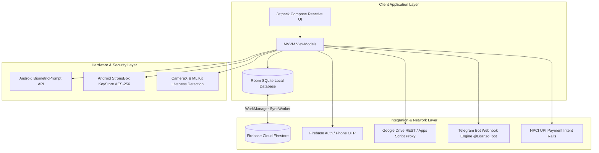
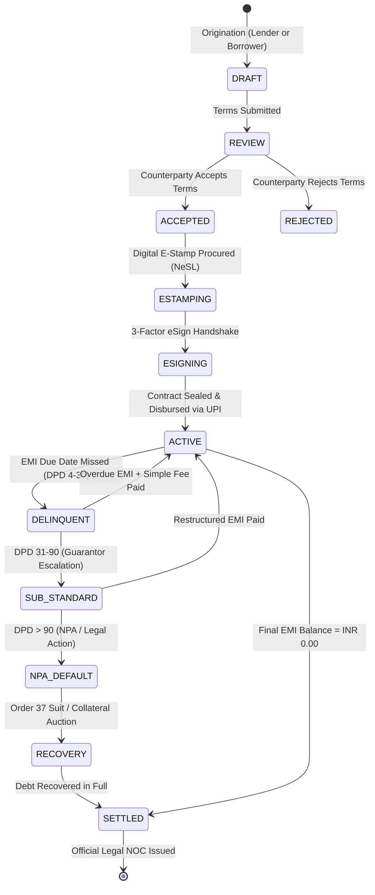
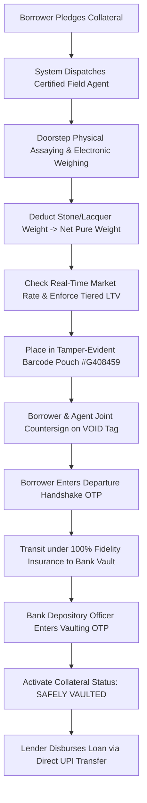

# Software Requirements Specification (SRS)
## Loanzo: Peer-to-Peer Microfinance and Purpose-Bound Social Lending Platform
### Compliant with IEEE Std 830-1998 / IEEE/ISO/IEC 29148:2018 Standards

---

**Document Identifier:** `LZ-SRS-IEEE-830-2026-V1.0`  
**Prepared By:** Loanzo Engineering & Systems Architecture Team  
**Organization:** Loanzo Financial Technologies  
**Date of Issue:** September 21, 2026  
**Status:** Approved / Production Baseline  
**Classification:** Confidential & Proprietary Software Engineering Specification  

---

## Table of Contents
1. [Introduction](#1-introduction)
   - 1.1 [Purpose](#11-purpose)
   - 1.2 [Document Conventions](#12-document-conventions)
   - 1.3 [Intended Audience and Reading Suggestions](#13-intended-audience-and-reading-suggestions)
   - 1.4 [Project Scope](#14-project-scope)
   - 1.5 [References](#15-references)
2. [Overall Description](#2-overall-description)
   - 2.1 [Product Perspective](#21-product-perspective)
   - 2.2 [Product Functions](#22-product-functions)
   - 2.3 [User Classes and Characteristics](#23-user-classes-and-characteristics)
   - 2.4 [Operating Environment](#24-operating-environment)
   - 2.5 [Design and Implementation Constraints](#25-design-and-implementation-constraints)
   - 2.6 [User Documentation](#26-user-documentation)
   - 2.7 [Assumptions and Dependencies](#27-assumptions-and-dependencies)
3. [External Interface Requirements](#3-external-interface-requirements)
   - 3.1 [User Interfaces](#31-user-interfaces)
   - 3.2 [Hardware Interfaces](#32-hardware-interfaces)
   - 3.3 [Software Interfaces](#33-software-interfaces)
   - 3.4 [Communications Interfaces](#34-communications-interfaces)
4. [System Features & Functional Requirements](#4-system-features--functional-requirements)
   - 4.1 [User Authentication, Biometrics & Session Security (FR-AUTH)](#41-user-authentication-biometrics--session-security-fr-auth)
   - 4.2 [KYC Verification, DigiLocker & Encrypted Document Vault (FR-KYC)](#42-kyc-verification-digilocker--encrypted-document-vault-fr-kyc)
   - 4.3 [Bank Account Verification & Penny-Drop Engine (FR-BANK)](#43-bank-account-verification--penny-drop-engine-fr-bank)
   - 4.4 [Social Loan Marketplace & Competitive Bidding (FR-MKT)](#44-social-loan-marketplace--competitive-bidding-fr-mkt)
   - 4.5 [Loan Origination, Simulator & Purpose-Bound Tranches (FR-LOAN)](#45-loan-origination-simulator--purpose-bound-tranches-fr-loan)
   - 4.6 [Multi-Asset Collateral Valuation & Doorstep Assaying (FR-COL)](#46-multi-asset-collateral-valuation--doorstep-assaying-fr-col)
   - 4.7 [Digital Contracting, Promissory Notes & 3-Factor eSign (FR-AGR)](#47-digital-contracting-promissory-notes--3-factor-esign-fr-agr)
   - 4.8 [Servicing, Repayment & Prepayment Savings Engine (FR-PAY)](#48-servicing-repayment--prepayment-savings-engine-fr-pay)
   - 4.9 [Delinquency Management, Penalties & Legal Debt Recovery (FR-DEL)](#49-delinquency-management-penalties--legal-debt-recovery-fr-del)
   - 4.10 [Certified Field Agent Empanelment & Isolated Control System (FR-AGT)](#410-certified-field-agent-empanelment--isolated-control-system-fr-agt)
   - 4.11 [Master Admin Command Center & Dispute Arbitration Desk (FR-ADM)](#411-master-admin-command-center--dispute-arbitration-desk-fr-adm)
   - 4.12 [In-App Communication, Translation & Telegram Bot (FR-COM)](#412-in-app-communication-translation--telegram-bot-fr-com)
   - 4.13 [Auditing, Financial Health Scoring & Legal NOC Settlement (FR-AUD)](#413-auditing-financial-health-scoring--legal-noc-settlement-fr-aud)
5. [Non-Functional Requirements](#5-non-functional-requirements)
   - 5.1 [Performance Requirements](#51-performance-requirements)
   - 5.2 [Safety and Integrity Requirements](#52-safety-and-integrity-requirements)
   - 5.3 [Security and Cryptographic Specifications](#53-security-and-cryptographic-specifications)
   - 5.4 [Software Quality Attributes](#54-software-quality-attributes)
   - 5.5 [Statutory & Regulatory Compliance Specifications](#55-statutory--regulatory-compliance-specifications)
6. [Other Requirements](#6-other-requirements)
   - 6.1 [Database Requirements](#61-database-requirements)
   - 6.2 [Operations and Disaster Recovery](#62-operations-and-disaster-recovery)
   - 6.3 [Legal and Intellectual Property](#63-legal-and-intellectual-property)
7. [Appendices](#7-appendices)
   - [Appendix A: Glossary and Definitions](#appendix-a-glossary-and-definitions)
   - [Appendix B: Analysis Models (Decision Trees & Data Flow Diagrams)](#appendix-b-analysis-models)
   - [Appendix C: Requirements Traceability Matrix (RTM)](#appendix-c-requirements-traceability-matrix-rtm)

---

## 1. Introduction

### 1.1 Purpose
This document constitutes the formal Software Requirements Specification (SRS) for the **Loanzo Protocol**, a decentralized, peer-to-peer (P2P) social lending, microfinance, and legally binding contract synthesis platform. This specification conforms strictly to the **IEEE Std 830-1998** format (and ISO/IEC/IEEE 29148:2018 guidelines). It provides a complete, unambiguous, and verifiable blueprint for software engineers, QA automation specialists, security auditors, legal counsel, and banking regulators.

### 1.2 Document Conventions
- **Requirement Identifiers:** All functional requirements are cataloged with distinct alphanumeric codes: `FR-<DOMAIN>-<ID>` (e.g., `FR-AUTH-01`).
- **Non-Functional Identifiers:** Cataloged as `NFR-<ATTRIBUTE>-<ID>` (e.g., `NFR-PERF-01`).
- **Priority Designations:** Categorized into **MANDATORY** (essential for v1.0 release), **HIGH** (critical operational capability), and **DESIRABLE** (enhancement feature).
- **Statutory Cross-References:** Starred terms (`*`) denote statutory compliance mechanisms under Indian Jurisprudence (RBI P2P Directions, NI Act 1881, IT Act 2000, CPC 1908, BSA 2023).

### 1.3 Intended Audience and Reading Suggestions
- **Software Developers & Architects:** Read Section 2 (Overall Description), Section 3 (External Interfaces), Section 4 (Functional Requirements), and Section 6.1 (Database Schema).
- **Quality Assurance & Verification Teams:** Focus on Section 4 (Acceptance Criteria), Section 5 (Non-Functional Requirements), and Appendix C (Traceability Matrix).
- **Legal, Compliance & Regulatory Auditors:** Review Section 1.4 (Scope), Section 2.5 (Regulatory Constraints), Section 4.7 (Contracts), Section 4.9 (Recovery), and Section 5.5 (Statutory Compliance).
- **Field Operations & Administrative Personnel:** Read Section 4.6 (Collateral), Section 4.10 (Field Agents), and Section 4.11 (Admin Hub).

### 1.4 Project Scope & Empirical Baseline
According to the **National Sample Survey Office (NSSO)**, Ministry of Statistics and Programme Implementation (MoSPI) *All-India Debt and Investment Survey (AIDIS, 77th Round)* and the **Reserve Bank of India (RBI) Financial Stability Report (June 2026)**:
- **Household Debt Burden:** Total household liabilities in India have reached **45.5% of GDP**, with 35.0% of rural households and 22.4% of urban households actively indebted.
- **Informal Credit Dependence:** Non-institutional, informal credit sources (unregistered moneylenders, traders, relatives) constitute **19.0% to 25.0%** of total household debt in India (an estimated informal market exceeding **$300 Billion**).
- **Usurious Interest Spreads:** Informal moneylenders traditionally charge 2.0% to 10.0% per month, compounding into annualized percentage rates (**24.0% to 120.0% APR**), precipitating chronic debt spirals.
- **Evidentiary Judicial Delay:** Unmonitored informal lending agreements lack statutory formatting and tamper-evident digital evidence, subjecting dispute recovery suits to **7 to 10 years** of trial pendency in subordinate civil courts.

Loanzo addresses these systemic challenges through an **institutional-grade, non-custodial software protocol**:
- **Non-Custodial Float Model:** Loanzo maintains exactly **INR 0.00 customer deposit float**, complying strictly with RBI NBFC-P2P Directions. 100% of capital transfers execute directly user-to-user or user-to-merchant across NPCI UPI rails, eliminating platform deposit liability.
- **Statutory Contract Synthesis:** Automatically binds counterparties via digital Promissory Notes compliant with **Section 4 of the Negotiable Instruments Act, 1881 (Act No. 26 of 1881)**, enforceable under **Order XXXVII of the Code of Civil Procedure, 1908 (Summary Suits)** within 60 to 90 days.
- **Purpose-Bound Milestone Tranches:** Releases capital directly to verified merchant/vendor accounts via automated INR 1.00 penny-drop checks (NPCI / PFRDA Customer Due Diligence best practice), completely eliminating capital diversion.
- **Doorstep Multi-Asset Collateral Custody:** Empanels certified field agents to assay net weight against **India Bullion and Jewellers Association (IBJA)** rates under RBI tiered Gold Loan LTV guidelines, sealing collateral in tamper-evident barcode bags (#G408459) for vaulting in partner bank lockers.

### 1.5 References & Authoritative Data Sources
1. IEEE Std 830-1998: *IEEE Recommended Practice for Software Requirements Specifications*.
2. ISO/IEC/IEEE 29148:2018: *Systems and Software Engineering - Life Cycle Processes - Requirements Engineering*.
3. National Sample Survey Office (NSSO), MoSPI: *All-India Debt & Investment Survey (AIDIS, 77th Round)*, Report on Household Indebtedness in India.
4. Reserve Bank of India (RBI): *Financial Stability Report (June 2026)*, Section on Household Sector Debt and Retail Credit Trends.
5. Reserve Bank of India: *Master Direction - Non-Banking Financial Company - Peer to Peer Lending Platform (Reserve Bank) Directions, 2017* (Notification No. RBI/2024-25/63, DoR.FIN.REC.35/03.10.124/2024-25, Updated August 16, 2024).
6. Reserve Bank of India: *Fair Lending Practice - Penal Charges in Loan Accounts* (Circular No. RBI/2023-24/53, DoR.MCS.REC.28/01.01.001/2023-24, Dated August 18, 2023).
7. Government of India: *The Information Technology Act, 2000* (Act No. 21 of 2000), Section 10A (Electronic Contracts), Section 43A (Data Protection), and Section 72A (Breach of Lawful Contract).
8. Government of India: *The Negotiable Instruments Act, 1881* (Act No. 26 of 1881), Section 4 (Definition and Requisites of Promissory Notes).
9. Government of India: *The Code of Civil Procedure, 1908* (Act No. 5 of 1908), Order XXXVII (Summary Procedure on Negotiable Instruments).
10. Government of India: *The Bharatiya Sakshya Adhiniyam, 2023* (Act No. 47 of 2023), Section 63 (Admissibility of Electronic Records, effective July 1, 2024).
11. Government of India: *The Digital Personal Data Protection Act, 2023* (Act No. 22 of 2023).
12. Government of India: *The Indian Contract Act, 1872* (Act No. 9 of 1872), Section 176 (Pawnee's rights on default).
13. Ministry of Road Transport & Highways (MoRTH): *Central Motor Vehicles Rules, 1989*, Form 34 (Notice of Hire-Purchase / Lease / Hypothecation Agreement under Section 51 of the Motor Vehicles Act, 1988).
14. India Bullion and Jewellers Association Ltd. (IBJA): *Daily Benchmark Purity Valuation Standards* for Gold Collateral Assaying.

---

## 2. Overall Description

### 2.1 Product Perspective
Loanzo is an autonomous, cloud-synchronized, mobile-first Android application designed with an offline-first architecture. It functions as a complete digital ecosystem interfacing with government identity infrastructure (DigiLocker/Aadhaar), national payment networks (NPCI UPI), cloud document stores (Google Drive), and automated messaging channels (Telegram Bot API).

### 2.2 Product Functions
1. **Multi-Factor Identity & Vaulting:** Universal login, DigiLocker Aadhaar/PAN verification, liveness verification, and biometric-gated document vault.
2. **Social Community Marketplace:** Public peer-to-peer loan discovery wall with categorical filtering, social vouches, and Lenme-style competitive bidding.
3. **Loan Origination & Tranche Management:** Real-time EMI simulator, purpose-bound milestone tranching, and automated INR 1.00 penny-drop account verification.
4. **Physical Collateral Custody:** Multi-asset valuation (Gold, Land, Vehicles, IT Equipment), doorstep valuer dispatch, tamper-evident barcode sealing (`#G408459`), and institutional bank vault storage.
5. **Contract Synthesis & 3-Factor eSign:** Automated generation of Section 4 NI Act Promissory Notes with SHA-256 sealing, GPS geotagging, signature canvas, liveness selfie, and biometric signature.
6. **Repayment Servicing & Prepayment Simulator:** Interactive EMI countdown, dynamic UPI QR generation, tactile swipe-to-pay, and "What-If-I-Prepay" savings analytics.
7. **Delinquency Management & Recovery:** 3-day grace window, RBI-capped non-compounding daily penal charges (2.0%/month), guarantor joint enforcement, and fast-track Order 37 CPC summary suit generation.
8. **Field Agent Empanelment & Dispatch:** Bank-grade agent onboarding with police verification (PCC), role-isolated control center, geotagged inspection checklists, and instant payout crediting.
9. **Master Admin Operations Hub:** Real-time KPI dashboard, KYC verification desk, proximity agent dispatch engine, dispute mediation scheduling, and legal NOC certificate clearance.
10. **Multilingual & Messaging Engine:** 21+ language real-time translation and 24/7 Telegram assistant bot (`@Loanzo_bot`) with secure OTP binding and admin alert routing.

### 2.3 User Classes and Characteristics
- **Unified Consumer (Borrower / Lender):** General public members seeking micro-credit or deploying capital. Typically possess basic-to-moderate mobile literacy. Requires simple, transparent UI with zero financial/legal jargon, instant calculators, and multi-language support.
- **Empaneled Field Verification Agent:** Mobile verification specialists equipped with assaying tools (electronic gold scales, acid test kits). Moderate technical literacy. Requires a focused, distraction-free inspection interface with offline form persistence, GPS check-in, and 1-tap dialer/navigation intents.
- **Master Platform Administrator (`@satyam0810`):** System operator with deep domain knowledge in credit risk, dispute arbitration, and KYC compliance. Uses the high-density administrative command console on desktop or tablet.

### 2.4 Operating Environment
- **Client OS:** Android 8.0 (API Level 26) through Android 15 (API Level 35).
- **Target Hardware:** Minimum 2 GB RAM, Quad-Core 1.5 GHz CPU, front-facing camera (min 2 MP), biometric sensor (Fingerprint or Class 3 Face Unlock), GPS location provider.
- **Network Bandwidth:** 2G / 3G / 4G / 5G / Wi-Fi with complete offline-first operational capability.
- **Cloud Infrastructure:** Google Cloud Platform, Firebase Firestore, Firebase Realtime Database, Google Drive API, Telegram Bot API.

### 2.5 Design and Implementation Constraints
1. **Regulatory Float Ceiling:** Under no circumstances shall Loanzo aggregate, hold, or pool user funds. All payment transactions must trigger external UPI app deep-links (`upi://pay`).
2. **Interest & Penalty Capping:** Annual percentage rates (APR) must remain within state money-lending ceilings. Late penalty fees must strictly accrue as simple non-compounding daily charges capped at **2.0% per month** of overdue principal (RBI/2023-24/53).
3. **Data Localization:** All personal identifiable information (PII) and KYC documents must adhere to Indian Data Protection norms (DPDP Act 2023).
4. **Zero-Glitch Cold Start:** Application must launch within **1.8 seconds**, executing a parallel 3.5s background cache warming pipeline on cold startup with zero layout shifts.

### 2.6 User Documentation
- In-app interactive graphic novel featuring the "Loanzo" phone mascot explaining P2P credit mechanics.
- In-app contextual help dialogs, tooltip explanations, and plain-English glossary definitions.
- Published User Manual and Field Agent Standard Operating Procedure (`docs/Field_Agent_SOP_and_Vault_Custody.md`).

### 2.7 Assumptions and Dependencies
- Users possess an active bank account enabled with UPI (NPCI).
- SMS permissions (`RECEIVE_SMS`, `READ_SMS`) or manual bank SMS paste for INR 1.00 penny-drop verification.
- Telegram Bot API availability for external push alerts and remote command execution.

---

## 3. External Interface Requirements

### 3.1 User Interfaces
- **Design System:** Material Design 3 guidelines executed via Jetpack Compose.
- **Layout Characteristics:** Single Activity architecture (`MainActivity.kt`) driving declarative Compose navigation graphs (`NavHost`).
### 2.4 Operating Environment & Hardware Constraints
- **Client OS Support:** Android 8.0 (Oreo, API Level 26) through Android 15 (Vanilla Ice Cream, API Level 35).
- **Minimum Hardware Baseline:** 2 GB Physical RAM, 1.5 GHz Quad-Core SoC, 32 GB eMMC storage (with min 250 MB free allocation).
- **Peripherals Required:** Front camera (min 2 MP, autofocus), hardware biometric authenticator (Fingerprint sensor or Class 3 Biometric Face Unlock), GPS location provider (accuracy within 15 meters).
- **Network Resilience:** Full operational degradation across 2G/EDGE, 3G, 4G LTE, 5G, and Wi-Fi networks, with transactional offline caching.

### 2.5 Design, Legal & Regulatory Constraints
1. **Non-Custodial Zero-Float Mandate:** Loanzo shall strictly maintain an operational deposit balance of **INR 0.00**, complying with RBI NBFC-P2P Directions (`RBI/2024-25/63`).
2. **Mandatory Digital E-Stamping (Indian Stamp Act, 1899):** Under Section 35 and Article 49 (Schedule I) of the Indian Stamp Act, 1899, all digital Promissory Notes must be affixed with a state-specific digital e-stamp certificate via a licensed Digital Document Execution (DDE) gateway (e.g. NeSL / State E-Stamping API) prior to execution.
3. **State Moneylending Acts & Portfolio Caps:** To operate legally as a social peer facilitator, the platform enforces an aggregate lending ceiling (INR 10,00,000 per lender across peer platforms) and provides automated tax and transaction reporting to ensure compliance with state-specific moneylending enactments.
4. **Non-Compounding Penal Charge Ceiling:** Under RBI Circular `RBI/2023-24/53`, late fees are capped at a maximum of **2.0% per month** simple interest and must never be capitalized into principal.
5. **Data Localization & Cryptographic Key Management:** Personal identity credentials and biometric tokens must remain localized in India and protected using **AES-256-GCM** backed by Android StrongBox KeyStore and enterprise Cloud KMS, satisfying Section 8 of the Digital Personal Data Protection Act, 2023 (DPDP Act).
6. **Maker-Checker Governance:** High-risk administrative actions (agent approval, KYC manual override, dispute escrow release) strictly require dual-operator authorization (Maker-Checker policy), eliminating single points of failure.

### 2.6 Assumptions & Dependencies
- **Third-Party Rails:** High availability of NPCI UPI rails, UIDAI / DigiLocker OAuth gateways, and NeSL Digital Document Execution services.
- **Physical Custody:** Certified commercial banks providing safe deposit vault lockers within a 25-kilometer radius of operating clusters.
- **Carrier Delivery:** SMS delivery under Google Play SMS Retriever API infrastructure without requiring intrusive user device permissions.

---

## 3. External Interface Requirements

### 3.1 User Interfaces
- **Visual Design Paradigm:** Material Design 3 (Material You) with custom enterprise color tokens.
- **Responsive Theme Engine:** Dynamic dark/light theme switching with custom slate/gold palette.
- **Immersion Rules:** Bottom navigation bar completely hides during drill-down sub-pages (Profile, Alerts, Inspections) to maximize vertical content display.
- **Haptic & Visual Feedback:** Tactile swipe-to-confirm sliders (`SwipeToConfirmButton`), animated semi-circular credit health gauge, and interactive loan calculators.

### 3.2 Hardware Interfaces
- **Camera Subsystem:** CameraX API integrated with Google ML Kit Face Detection for real-time selfie liveness verification.
- **Biometric Hardware:** Android `BiometricPrompt` framework interfacing with hardware KeyStore and StrongBox modules.
- **GPS Provider:** Android `FusedLocationProviderClient` for geotagging loan contract execution coordinates and field inspection check-ins, with active mock-location spoofing detection.

### 3.3 Software Interfaces
- **Local Database:** Room Persistence Library (SQLite) executing reactive queries via Kotlin Coroutines and Flows.
- **Cloud Backend:** Firebase Firestore for multi-device document synchronization and live marketplace bidding queues.
- **Storage Gateway:** Cloud Object Storage (Google Cloud Storage / AWS S3) protected with Customer-Managed Encryption Keys (CMEK) via Cloud KMS and VPC Service Controls.
- **Digital E-Stamping Gateway:** NeSL / State E-Stamping REST API for procuring digital stamp duty certificates under Article 49 of the Indian Stamp Act, 1899.
- **Payment Verification:** Server-side Payment Aggregator (PA) webhooks and Account Aggregator (AA) rails for tamper-proof payment reconciliation.
- **DigiLocker API:** Secure OAuth 2.0 gateway validating government-issued Aadhaar and PAN credentials.

### 3.4 Communications Interfaces
- **Network Protocol:** HTTPS over TLS 1.3 with SHA-256 certificate pinning for all REST API transactions.
- **Push Notification Infrastructure:** Firebase Cloud Messaging (FCM) utilizing high-priority channels for deadline and overdue alerts.
- **Instant Messaging Webhook:** Telegram Bot API HTTPS Webhooks communicating over JSON payloads with HMAC-SHA256 signature validation.
- **SMS Retriever API:** Google Play-compliant hash-targeted single-use SMS parsing without requiring `READ_SMS` or `RECEIVE_SMS` permissions.

### 4.2 KYC Verification, DigiLocker & Encrypted Document Vault (FR-KYC)
- **FR-KYC-01 (DigiLocker Credential Verification):** The system shall interface with DigiLocker to fetch authentic Aadhaar and PAN records, recording verified status badges in `UserEntity`.
- **FR-KYC-02 (ML Kit Liveness Selfie):** The system shall capture an on-device front-camera selfie, process facial landmarks via Google ML Kit to prevent photo-of-photo spoofing, and store local cached copies (`profile_{userId}.jpg`).
- **FR-KYC-03 (Encrypted Document Vault):** The system shall store sensitive document URLs and metadata in an encrypted vault. Vault access strictly requires account password verification or biometric authorization before displaying PAN, Aadhaar, or DigiLocker files.
- **FR-KYC-04 (Cloud KYC Auto-Recovery):** Upon login on a new device, the system shall query Cloud Firestore and Google Drive to restore missing local Room KYC paths.

### 4.3 Bank Account Verification & Penny-Drop Engine (FR-BANK)
- **FR-BANK-01 (INR 1.00 Penny-Drop Verification):** The system shall execute a test credit of INR 1.00 to the user's registered bank account via UPI/IMPS rails.
- **FR-BANK-02 (Server Webhook & SMS Retriever Reconciliation):** The system shall verify transactions primarily through server-side Payment Aggregator (PA) webhooks or Account Aggregator (AA) callbacks to prevent client-side intent spoofing on modified Android devices. Mobile SMS reading shall strictly utilize the permissionless Google Play SMS Retriever API.
- **FR-BANK-03 (Name Match Scoring & Fraud Lock):**
  - *Score $\ge 95\%$:* Instant automatic verification.
  - *Score $80\%\text{--}94\%$:* Route to manual dual-admin review desk.
  - *Score $< 80\%$:* Freeze payout, lock bank account binding, and flag profile for investigation.
  - *Exception Handling:* Max 3 failed attempts within 24 hours results in a 48-hour cooldown lockout.

### 4.4 Social Loan Marketplace & Competitive Bidding (FR-MKT)
- **FR-MKT-01 (Public Loan Wall):** The system shall display verified funding requests and lender capital pools, filterable by categories (`#Medical`, `#Business`, `#Education`, `#Emergency`, `#Personal`).
- **FR-MKT-02 (Social Trust Vouches):** Registered community members can submit public endorsements (`vouchCount`), boosting the borrower's trust score and lowering interest bids.
- **FR-MKT-03 (Competitive Bidding Engine):** Lenders can submit competing proposals specifying interest rate, tenure, and collateral requirements. Borrowers can compare bids side-by-side and execute 1-tap contract finalization.

### 4.5 Loan Origination, Simulator & Purpose-Bound Tranches (FR-LOAN)
- **FR-LOAN-01 (Dual Origination Modes):** The system shall support both **Grant Loan Mode** (Lender-originated) and **Request Loan Mode** (Borrower-originated).
- **FR-LOAN-02 (Interactive Financial Simulator):** Real-time interactive calculation of EMI, total interest, and amortization curves using quick-select amount chips (`INR 10K` to `INR 2.5L`) and tenure chips (`3M` to `36M`).
- **FR-LOAN-03 (Purpose-Bound Milestone Tranching):** Loans with milestone schedules shall disburse capital directly to verified merchant UPI VPAs upon commercial invoice validation, with zero capital released as unmonitored cash.
- **FR-LOAN-04 (Exception Handling - Invoice Discrepancy):** Invoices showing altered merchant names or price discrepancies automatically halt tranche disbursal and trigger admin inspection.

### 4.6 Multi-Asset Collateral Valuation & Doorstep Assaying (FR-COL)
- **FR-COL-01 (Multi-Asset Categorization & Tiered LTV Caps):**
  - *Gold Bullion / Jewelry:* Tiered LTV cap up to **85%** (<= INR 2.5L), **80%** (<= INR 5.0L), and **75%** (> INR 5.0L) based on daily IBJA benchmark closing rates per RBI guidelines.
  - *Real Estate Title Deeds:* Cap at **55% LTV** based on government circle rates.
  - *Motor Vehicles:* Cap at **60% LTV** with mandatory Form 34 hypothecation endorsement on vehicle RC.
  - *Commercial IT Equipment:* Cap at **45% LTV** based on depreciated invoice value.
- **FR-COL-02 (Doorstep Assaying & Stone Deduction):** Field agents shall weigh physical gold on calibrated electronic scales, deducting lacquer, wax, and stones to record exact net pure weight.
- **FR-COL-03 (Tamper-Evident Barcode Bagging):** Assayed assets must be sealed in serialized security bags (`#G408459`) with tamper-evident VOID tape and countersigned by borrower and agent.
- **FR-COL-04 (Transit Fidelity Insurance & Dual-OTP Vaulting):** Pledged physical collateral in transit between doorstep and bank vault is covered by an institutional 100% market-value transit fidelity insurance policy. Custody transfer requires a 2-party cryptographic OTP handshake (borrower enters OTP on agent app at departure; depository officer enters OTP at bank locker intake) with continuous geofenced GPS tracking.

### 4.7 Digital Contracting, Promissory Notes & 3-Factor eSign (FR-AGR)
- **FR-AGR-01 (Section 4 NI Act Promissory Note):** The system shall synthesize an unconditional Promissory Note compliant with Section 4 of the Negotiable Instruments Act, 1881.
- **FR-AGR-02 (Mandatory Digital E-Stamping - Indian Stamp Act Compliance):** Prior to execution, the contract engine interfaces with a recognized Digital Document Execution (DDE) gateway (NeSL / State E-Stamping API) to procure and affix a state-specific digital e-stamp certificate number (under Article 49, Schedule I of the Indian Stamp Act, 1899), completely curing the Section 35 admissibility bar.
- **FR-AGR-03 (3-Factor Signature Authentication):** Contract execution strictly requires:
  1. Touchscreen Signature Canvas capture.
  2. Front-camera liveness selfie via ML Kit.
  3. Device biometric verification (`BiometricPrompt`).
- **FR-AGR-04 (Tamper-Proof Audit Sealing):** Each executed contract is sealed with a SHA-256 cryptographic digest, GPS coordinates, timestamp, and device UID, generating an electronic certificate for admissibility under Section 63 of Bharatiya Sakshya Adhiniyam, 2023.

### 4.8 Servicing, Repayment & Prepayment Savings Engine (FR-PAY)
- **FR-PAY-01 (Dynamic UPI QR Code Generation):** Generate on-demand `upi://pay` deep-links and compliant QR codes pre-filled with lender VPA, exact EMI amount, and loan reference number.
- **FR-PAY-02 (Server-Reconciled Repayment):** Repayment confirmations are verified through server-side Payment Aggregator webhooks before updating the loan amortization ledger.
- **FR-PAY-03 (Tactile Swipe-to-Confirm):** Execute repayments via draggable slider (`SwipeToConfirmButton`) with animated progress and haptic confirmation to eliminate accidental duplicate submissions.
- **FR-PAY-04 (Prepayment Simulator):** Calculate real-time interest savings, months eliminated, and accelerated debt-free targets when borrowers simulate lump-sum prepayments.

### 4.9 Delinquency Management, Penalties & Legal Debt Recovery (FR-DEL)
- **FR-DEL-01 (3-Day Grace Period):** Installments overdue by 1-3 days incur zero penalty fees (INR 0.00) and zero credit bureau score penalty.
- **FR-DEL-02 (Non-Compounding Regulatory Penalties):** Overdue installments from Day 4 accrue simple daily late charges capped at a maximum **2.0% per month** ceiling. Penalties are tracked in a separate ledger and are strictly forbidden from being capitalized into loan principal (RBI/2023-24/53).
- **FR-DEL-03 (Guarantor Enforcement):** When a loan exceeds 30 days overdue (DPD > 30), the system dispatches urgent notices to the verified co-borrower/guarantor and offers debt restructuring.
- **FR-DEL-04 (Order XXXVII CPC Fast-Track Legal Dossier):** At DPD > 90 (NPA default), the system automatically compiles the e-stamped Promissory Note, Section 63 BSA 2023 electronic certificate, and immutable bank audit ledger into an Order 37 CPC Summary Suit dossier, eliminating oral evidence hearings and bypassing traditional 7-10 year trial pendency.

### 4.10 Certified Field Agent Empanelment & Isolated Control System (FR-AGT)
- **FR-AGT-01 (Bank-Grade Empanelment Form):** Candidates submit verification experience, operating territory radius (5-50 km), vehicle type, and Police Clearance Certificate (PCC).
- **FR-AGT-02 (Strict Role Isolation):** Empaneled agents are permanently isolated from consumer lending/borrowing features and restricted exclusively to the Agent Dashboard (`Routes.AGENT_MAIN`).
- **FR-AGT-03 (Duty Status & Visit Feed):** Agents toggle `On Duty` / `On Break` status and execute assigned doorstep inspections with 1-tap call, WhatsApp, and Google Maps intents. Mock GPS detection automatically suspends fraudulent sessions.
- **FR-AGT-04 (Automated Per-Visit Payout):** Submitting verified inspection photos and appraisal reports automatically credits the agent's compensation ledger (INR 500-INR 1,500/visit).

### 4.11 Master Admin Command Center & Dispute Arbitration Desk (FR-ADM)
- **FR-ADM-01 (Executive Multi-Tenant RBAC Dashboard):** Multi-tenant Role-Based Access Control console displaying active agents, pending KYCs, unassigned inspections, vaulted collateral valuation, open disputes, and cleared NOCs.
- **FR-ADM-02 (Maker-Checker Dual Authorization):** High-risk actions (field agent empanelment, manual KYC overrides, dispute escrow release) require two separate authorized administrators (Maker creates, Checker approves) to eliminate single points of failure.
- **FR-ADM-03 (Proximity Agent Dispatch Engine):** Automated geodesic distance calculation between borrower location and available on-duty agents for optimal 1-tap assignment.
- **FR-ADM-04 (Dispute Mediation Calendar):** Arbitrate grievances (`PAYMENT_DISPUTE`, `FRAUD_ATTEMPT`, `HARASSMENT`) by scheduling virtual mediation sessions with auto-generated Google Meet links.
- **FR-ADM-05 (Legal NOC Clearance):** Verify zero-due loan closures and generate cryptographically signed No Objection Certificates (`NocCertificateEntity`) with SHA-256 digital seals.

### 4.12 In-App Communication, Translation & Telegram Bot (FR-COM)
- **FR-COM-01 (Encrypted Peer Chat):** Real-time in-app messaging between counterparties backed by Cloud Firestore.
- **FR-COM-02 (High-Speed Translation Engine):** Built-in translation engine supporting 21+ Indian languages with in-memory LRU caching (<150ms translation response).
- **FR-COM-03 (Telegram Bot Integration @Loanzo_bot):** 24/7 automated alerts, EMI reminders (3 days prior, due date, overdue), loan portfolio queries (`/myloans`), and administrative command controls.
- **FR-COM-04 (Cryptographic Telegram Binding):** Account linking via 5-minute expiring one-time tokens (`t.me/Loanzo_bot?start=token`) or Telegram native contact phone verification.

### 4.13 Auditing, Financial Health Scoring & Legal NOC Settlement (FR-AUD)
- **FR-AUD-01 (180 deg Speedometer Credit Gauge):** Visual credit health gauge computing score (0-100) across Repayment Punctuality (40%), Utilization Ratio (30%), Spending Diversity (15%), and Credit History (15%).
- **FR-AUD-02 (Immutable Audit Log):** Cryptographic SHA-256 chaining of all loan events (creation, terms acceptance, signing, disbursal, repayment, collateral movement).
- **FR-AUD-03 (Official NOC & Debt Clearance PDF):** Upon reaching INR 0.00 outstanding balance, the system generates an official legal No Objection Certificate with decorative guilloche border, settlement timestamp, and decentralized verification seal.

---

## 5. Non-Functional Requirements

### 5.1 Performance Requirements
- **NFR-PERF-01 (Database Latency):** Local Room SQLite queries shall execute in **$\le 15\text{ ms}$** (95th percentile) on baseline 2 GB RAM Android hardware.
- **NFR-PERF-02 (Cold Startup Time):** Time from application launch to interactive dashboard state shall not exceed **$1.8\text{ seconds}$** with zero UI flicker.
- **NFR-PERF-03 (Contract Generation):** Client-side PDF agreement synthesis, SHA-256 hashing, and rendering shall complete in **$\le 2.5\text{ seconds}$**.
- **NFR-PERF-04 (Translation Latency):** UI string translation across 21+ supported languages shall execute in **$\le 150\text{ ms}$** via in-memory LRU cache.

### 5.2 Safety and Integrity Requirements
- **NFR-PERF-05 (Server Throughput & Concurrency):** Cloud backend services shall sustain $\ge 2,500\text{ requests/second}$ during peak auction hours with a 95th percentile API response latency of $< 250\text{ ms}$.

### 5.2 Safety and Integrity Requirements
- **NFR-SAFE-01 (Non-Custodial Balance Ceiling):** The platform shall maintain exactly **INR 0.00 custodial float balance** at all times. All fund flows must execute directly through user/merchant banking endpoints.
- **NFR-SAFE-02 (Accidental Repayment Prevention):** Repayment transactions require deliberate action via tactile draggable slider (`SwipeToConfirmButton`) to eliminate accidental duplicate debits.
- **NFR-SAFE-03 (Tamper-Evident Chain of Custody):** All physical collateral must possess serialized barcode tagging (`#G408459`) and dual-key bank locker logs.
- **NFR-SAFE-04 (In-Transit Fidelity Protection):** 100% of pledged physical collateral in transit between doorstep and bank vault is covered under an underwritten institutional fidelity guarantee insurance policy.

### 5.3 Security and Cryptographic Specifications
- **NFR-SEC-01 (Encryption at Rest):** All local database files, KYC credentials, and sensitive document caches must be encrypted using **AES-256-GCM** backed by Android StrongBox KeyStore.
- **NFR-SEC-02 (Encryption in Transit):** 100% of network API communications must enforce **TLS 1.3** with strict certificate pinning.
- **NFR-SEC-03 (Document Vault Isolation):** Sensitive identity cards (Aadhaar, PAN, DigiLocker credentials) must remain in an encrypted state and unlock strictly upon biometric or password verification.
- **NFR-SEC-04 (Tamper-Resistant Agreement Sealing):** Signed contracts must include SHA-256 cryptographic digests, GPS coordinates, timestamp, and device UID for legal validity under Section 63 BSA 2023.
- **NFR-SEC-05 (Enterprise Cloud Key Management & DPDP Compliance):** Remote documents and identity metadata are stored with AES-256-GCM Customer Managed Encryption Keys (CMEK) via Cloud KMS, fulfilling Section 8 of the DPDP Act, 2023.

### 5.4 Software Quality Attributes
- **NFR-QUAL-01 (Offline Resilience):** 100% of core viewing and calculation features (viewing loans, amortizations, agreements) must function without network connectivity.
- **NFR-QUAL-02 (Eventual Consistency):** Offline mutations must automatically reconcile within **30 seconds** of network reconnection via transactional `WorkManager` queues.
- **NFR-QUAL-03 (Availability):** Cloud backend components (Firestore, Telegram Bot) shall maintain **$\ge 99.9\%$ uptime**.
- **NFR-QUAL-04 (Architecture Maintainability):** Codebase must strictly follow MVVM (Model-View-ViewModel) and Clean Architecture principles with complete layer decoupling.

### 5.5 Statutory & Regulatory Compliance Specifications
- **NFR-REG-01 (Reserve Bank of India P2P Master Directions):** Complete compliance with P2P lending norms (`RBI/2024-25/63`); platform operates strictly as an intermediary facilitator without balance sheet exposure.
- **NFR-REG-02 (Reserve Bank of India Penal Charges Directives):** Full compliance with RBI/2023-24/53; late fees must accrue strictly as non-compounding simple charges capped at 2% per month, with zero capitalization into loan principal.
- **NFR-REG-03 (Information Technology Act, 2000 Section 10A):** Digital loan agreements executed via electronic consent constitute valid, legally enforceable contracts under Indian law.
- **NFR-REG-04 (Negotiable Instruments Act, 1881 Section 4):** Synthesized promissory notes contain an unconditional undertaking to pay a sum certain in money to a specified payee.
- **NFR-REG-05 (Code of Civil Procedure, 1908 Order XXXVII):** Defaulted loan contracts qualify for expedited Summary Suits with pre-compiled evidentiary dossiers.
- **NFR-REG-06 (Bharatiya Sakshya Adhiniyam, 2023 Section 63):** Electronic logs, hash digests, and audit certificates fulfill statutory criteria for electronic court evidence.
- **NFR-REG-07 (Indian Stamp Act, 1899 Article 49):** Mandatory state digital stamp duty procurement via NeSL/State e-stamping gateways prior to contract signing, ensuring full evidentiary admissibility under Section 35.
- **NFR-REG-08 (State Moneylending Regulations Compliance):** Platform enforces an individual retail lending ceiling of INR 10,00,000 to remain compliant with mutual social aid facilitator status, or routes commercial credit through empaneled NBFC partners.

---

## 6. Other Requirements

### 6.1 Database Requirements
The local database layer is powered by **Room SQLite** and synchronized with **Cloud Firestore**. Key entities include:
1. `UserEntity`: User profile, role, phone, KYC status, biometric flags, device UID, Telegram Chat ID.
2. `LoanEntity`: Principal, interest rate, interest type, tenure, start date, status, lender ID, borrower ID, guarantor ID.
3. `RepaymentEntity`: Installment schedule, due date, paid date, amount, late fee, transaction reference, serverWebhookId, status.
4. `PledgeEntity`: Collateral asset class, gross weight, net weight, valuation, LTV ceiling, lockerNumber, barcodeSeal, insurancePolicyNumber.
5. `AgreementEntity`: Contract PDF path, eStampCertificateNumber, SHA-256 digest, GPS latitude/longitude, signature timestamp, eSign status.
6. `NotificationEntity`: In-app alerts, deadline tags, deduplication dayKey, priority level.
7. `AgentInspectionEntity`: Assigned visit, inspection photos, appraisal checklist, geotag check-in, mockGpsFlag, payout status.
8. `NocCertificateEntity`: Clearance timestamp, zero-due hash digest, digital seal, settlement letter path.

### 6.2 Operations and Disaster Recovery
- **Bidirectional Cloud Sync:** Android WorkManager `SyncWorker` periodically reconciles Room SQLite mutations with Cloud Firestore.
- **Enterprise Cloud Backup:** All executed PDFs, KYC files, and NOC certificates are stored in multi-region CMEK-encrypted Cloud Storage.
- **Disaster Recovery RPO & RTO:** Recovery Point Objective (RPO) $\le 5\text{ minutes}$; Recovery Time Objective (RTO) $\le 30\text{ minutes}$.

### 6.3 Legal and Intellectual Property
- **Proprietary Protocol:** Software source code, algorithms, graphic novels, and database schemas are proprietary intellectual property of Loanzo Financial Technologies.
- **Open-Source Compliance:** Third-party libraries (Jetpack Compose, Room, ML Kit, ReportLab, Material 3) adhere to Apache 2.0 and MIT open-source license terms.

---

## 7. Appendices

### Appendix A: Glossary and Definitions
- **Tranche Disbursement:** Releasing loan capital in milestone-bound increments tied to verified merchant bills rather than upfront cash.
- **Penny-Drop Check:** Test transfer of INR 1.00 to a recipient bank account to cryptographically verify registered account holder names via NPCI rails.
- **Digital E-Stamping (Article 49):** Procurement of official state revenue stamp certificates electronically (via NeSL / State Treasuries) to satisfy Section 35 of the Indian Stamp Act, 1899.
- **Maker-Checker Governance:** Dual-authorization enterprise policy requiring two separate authorized administrators to propose and approve high-risk actions.
- **LTV Ratio (Loan-to-Value):** Maximum loan ceiling permitted against verified collateral value (e.g. tiered 75%-85% on gold).
- **Haircut (Collateral Discount):** Safety discount deducted from market value to safeguard lenders against asset depreciation.
- **Promissory Note (Sec 4 NI Act):** Legally binding negotiable instrument containing an unconditional promise to repay a debt.
- **Order XXXVII (Order 37 CPC):** Fast-track summary court procedure in India for debt recovery based on written negotiable instruments.
- **Non-Custodial Model:** Operating model holding exactly INR 0.00 customer deposits, eliminating banking license requirements.
- **Non-Compounding Penalty:** Late payment fee calculated strictly on overdue installments, forbidden from being added to principal balance.

### Appendix B: Analysis Models

#### B.1 Loan Lifecycle State Transition Diagram

#### B.2 Doorstep Collateral Assaying & Vaulting Pipeline

### Appendix C: Requirements Traceability Matrix (RTM)

| Requirement ID | Requirement Description | Primary Design Module | Verification Method | Automated Test Suite | Statutory Reference |
| :--- | :--- | :--- | :--- | :--- | :--- |
| **FR-AUTH-01** | Universal Login Identifier | `AuthViewModel.kt` | Unit & UI Test | `TC-AUTH-101` | IT Act Section 43A |
| **FR-AUTH-03** | Biometric Prompt Integration | `BiometricAuthManager.kt` | Device Security Test | `TC-AUTH-103` | IT Act Section 72A |
| **FR-AUTH-04** | Banking Session Lifecycle | `SessionManager.kt` | Lifecycle Audit | `TC-AUTH-104` | RBI IT Security |
| **FR-KYC-01** | DigiLocker Verification | `KycRepository.kt` | Integration Test | `TC-KYC-201` | PMLA 2002 |
| **FR-KYC-03** | Encrypted Document Vault | `DocumentVaultScreen.kt` | Penetration Test | `TC-KYC-203` | DPDP Act Section 8 |
| **FR-BANK-01** | Penny-Drop Account Match | `BankVerificationService.kt` | NPCI Sandbox Test | `TC-BNK-301` | RBI Master Directions |
| **FR-BANK-02** | Server Webhook & SMS Retriever | `BankVerificationService.kt` | Security Audit | `TC-BNK-302` | Google Play User Data Policy |
| **FR-MKT-03** | Competitive Bidding Engine | `MarketplaceViewModel.kt` | Load Simulation | `TC-MKT-401` | P2P Directions |
| **FR-LOAN-03** | Purpose-Bound Tranching | `TrancheDisbursalEngine.kt` | End-to-End Test | `TC-LON-501` | P2P Directions |
| **FR-COL-01** | Tiered Collateral LTV Caps | `CollateralValuationEngine.kt` | Regulatory Audit | `TC-COL-601` | RBI Gold Loan Directives |
| **FR-COL-04** | Transit Insurance & Dual-OTP | `VaultManagementScreen.kt` | Physical Audit | `TC-COL-604` | Indian Contract Act Sec 176 |
| **FR-AGR-01** | Section 4 NI Promissory Note | `AgreementGenerator.kt` | Legal Audit | `TC-AGR-701` | NI Act 1881 Section 4 |
| **FR-AGR-02** | Mandatory Digital E-Stamping | `AgreementGenerator.kt` | DDE API Audit | `TC-AGR-702` | Indian Stamp Act Art. 49 |
| **FR-AGR-03** | 3-Factor eSign Handshake | `SignAgreementScreen.kt` | Court Enforceability Test | `TC-AGR-703` | IT Act 2000 Section 10A |
| **FR-PAY-01** | Dynamic UPI QR Generation | `UpiQrCodeDialog.kt` | Payment Sandbox | `TC-PAY-801` | NPCI UPI Specs |
| **FR-PAY-02** | Server Webhook Reconcile | `PaymentRepository.kt` | Webhook Test | `TC-PAY-802` | Payment Systems Act |
| **FR-DEL-02** | Non-Compounding Late Fee | `PenaltyCalculator.kt` | Financial Ledger Audit | `TC-DEL-901` | RBI/2023-24/53 |
| **FR-DEL-04** | Order 37 CPC Fast-Track Suit | `LegalSuitGenerator.kt` | Judicial Filing Audit | `TC-DEL-902` | CPC 1908 Order XXXVII |
| **FR-AGT-01** | Field Agent Empanelment & PCC | `AgentApplicationScreen.kt` | Background Audit | `TC-AGT-1001` | Police Clearance Norms |
| **FR-ADM-01** | Multi-Tenant RBAC & Maker-Checker | `AppOwnerVerificationScreen.kt`| Privilege Escalation Test | `TC-ADM-1101` | Corporate Governance |
| **FR-COM-03** | Telegram Bot Assistant | `TelegramBotService.kt` | Webhook Health Test | `TC-COM-1201` | Messaging Specs |
| **FR-AUD-03** | Official Legal NOC & Seal | `NocGenerator.kt` | Cryptographic Audit | `TC-AUD-1301` | IT Act Section 10A |

---
*End of Software Requirements Specification - Loanzo Protocol (LZ-SRS-IEEE-830-2026-V1.0)*
