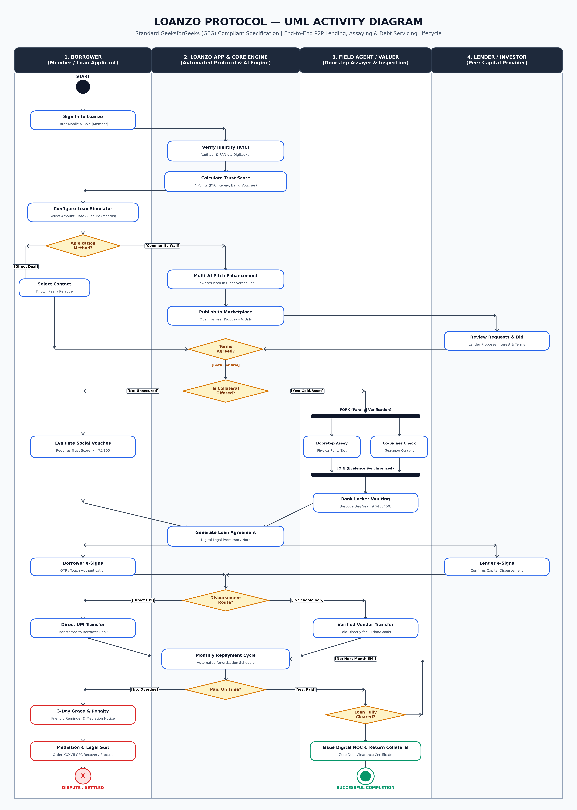
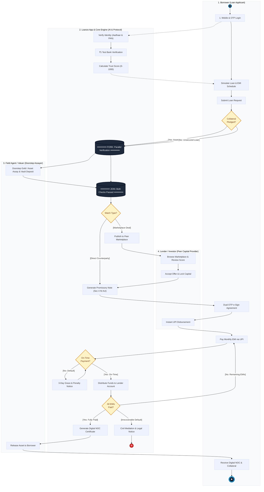

# Loanzo Protocol | GeeksforGeeks (GFG) UML Activity Diagram Specification

> **Project Name:** Loanzo – Peer-to-Peer Micro-Lending Platform  
> **Document Type:** Formal UML 2.5 Activity Diagram Specification & Implementation  
> **Target Audience:** General Public, Engineers, Auditors, and Academic Evaluators  
> **Standard:** GeeksforGeeks (GFG) Software Engineering UML Activity Diagram Guidelines  

---

## 1. Introduction & Overview (Simple English)

An **Activity Diagram** in software engineering is like an interactive visual map or flow chart. It shows the step-by-step journey of how a system works from start to finish. It highlights **who does what**, **where decisions are made** (e.g. Yes/No branches), and **when multiple things happen at the same time** (parallel tasks).

In **Loanzo**, the Activity Diagram tracks a complete loan journey:
1. A borrower joins and verifies their legal identity.
2. They request a loan (choosing either a collateral asset like gold or a regular personal loan with a co-borrower).
3. The platform matches them with an everyday investor (lender) or sets up a direct agreement.
4. A legally binding digital agreement is signed.
5. The money is securely disbursed.
6. The borrower pays back month-by-month installments.
7. Upon full payment, a Zero-Debt Clearance Certificate (NOC) is issued and any pledged items are returned safely.

---

## 2. Plain-English Glossary of Shortforms & Terms

To ensure this document is easily understood by everyone, here is a complete guide to all technical terms, financial abbreviations, and UML symbols used:

| Term / Abbreviation | Full Form / Plain Meaning | Everyday Real-World Example / Explanation |
| :--- | :--- | :--- |
| **EMI** | **Equated Monthly Installment** | A fixed payment amount made by a borrower to a lender at a specified date each month until the loan is completely paid off. |
| **KYC** | **Know Your Customer** | The mandatory legal process of verifying a person's real identity (e.g., verifying Aadhaar and PAN cards) to prevent fraud and identity theft. |
| **UPI** | **Unified Payments Interface** | India's instant real-time bank payment system (Google Pay, PhonePe, Paytm, BHIM) that moves funds directly between bank accounts instantly. |
| **NOC** | **No Objection Certificate** | An official legal document issued at the end of a loan confirming that all dues are 100% paid and the borrower owes zero money. |
| **LTV** | **Loan-to-Value Ratio** | The percentage of money you can borrow compared to the value of the asset you pledge. For example, if your gold is worth ₹1,00,000 and the LTV is 75%, you can borrow up to ₹75,000. |
| **Co-Borrower** | **Secondary Guarantee Signer** | A trusted family member or guarantor who signs the loan alongside the borrower and agrees to take responsibility if the borrower cannot pay. |
| **Promissory Note (Sec 4 NI Act)** | **Digital Legal IOU / Note** | Under Section 4 of the Negotiable Instruments Act, 1881, this is a written, legally binding promise signed by the borrower stating: *"I promise to pay back this exact amount on these dates."* It holds up in a court of law. |
| **Reducing Balance** | **Diminishing Interest Calculation** | A fair way to calculate interest where you only pay interest on the money you *still owe*, not on what you have already paid back. |
| **Assay / Assayer** | **Purity & Authenticity Testing** | An expert physical inspection (e.g., testing gold carat purity, weighing on certified scales) to ensure the pledged item is genuine. |
| **Swimlane** | **UML Responsibility Column** | A vertical column in the diagram that groups all actions performed by one specific person or system actor. |
| **Fork Node (`━━━`)** | **Split into Parallel Tasks** | A thick horizontal bar where one action splits into two or more actions happening at the exact same time. |
| **Join Node (`━━━`)** | **Combine Parallel Tasks** | A thick horizontal bar that waits until all parallel actions are finished before allowing the flow to move forward. |
| **Decision Node (`◇`)** | **Choice / Branching Diamond** | A diamond shape representing a decision point with guards (conditions like `[Yes]` or `[No]`). |
| **Initial State (`●`)** | **Start of the Flow** | A solid filled black circle indicating where the process begins. |
| **Final State (`◉`)** | **Successful Completion** | A bullseye circle indicating the successful completion of the entire activity. |
| **Flow Final (`⊗`)** | **Abnormal End / Exit** | A circle with an 'X' indicating the process stopped or exited due to cancellation, default, or dispute. |

---

## 3. High-Resolution Visual Diagram

The official GeeksforGeeks-compliant activity diagram has been rendered into a 300 DPI high-resolution diagram image:



*Direct image file location:* `docs/diagrams/activity_diagram_gfg.png`

---

## 4. The 4 Swimlanes & Actor Responsibilities

Following standard GFG UML guidelines, the system is separated into 4 distinct vertical swimlanes:

```
┌─────────────────────────────────┬─────────────────────────────────┬─────────────────────────────────┬─────────────────────────────────┐
│           SWIMLANE 1            │           SWIMLANE 2            │           SWIMLANE 3            │           SWIMLANE 4            │
│   Borrower (Loan Applicant)     │  Loanzo App & Core Engine (AI)  │   Field Agent / Valuer (Assay)  │    Lender / Peer Investor       │
├─────────────────────────────────┼─────────────────────────────────┼─────────────────────────────────┼─────────────────────────────────┤
│ • Registers with mobile & OTP   │ • Verifies Aadhaar/PAN (DigiLocker)│ • Receives Doorstep Task     │ • Explores Marketplace          │
│ • Simulates EMI & repayment plan│ • Runs ₹1 Penny-Drop bank test  │ • Conducts physical inspection  │ • Reviews Trust Score & notes   │
│ • Submits loan request          │ • Computes Trust Score (0-1000) │ • Verifies Gold purity / Carat  │ • Accepts counter-offers        │
│ • Digital OTP e-Sign Agreement  │ • Auto-matches Lenders          │ • Deposits asset in secure safe │ • Disburses funds via UPI       │
│ • Pays monthly EMIs via UPI     │ • Generates Promissory Note     │ • Releases asset upon NOC       │ • Receives monthly repayments   │
│ • Receives NOC & pledged asset  │ • Tracks Repayments & Grace     │                                 │ • Authorizes closure            │
└─────────────────────────────────┴─────────────────────────────────┴─────────────────────────────────┴─────────────────────────────────┘
```

---

## 5. Step-by-Step Flow Explanation (Phase by Phase)

### Phase 1: Onboarding, Identity & Financial Verification
1. **Initial State (`●`)**: The borrower installs the application and initiates registration.
2. **Mobile & OTP Authentication**: The user inputs their phone number and verifies the one-time password.
3. **Verify Identity (Aadhaar & PAN)**: The core engine performs digital KYC verification through official government verification APIs.
4. **₹1 Test Verification Transfer**: The core engine transfers ₹1 to the user's linked bank account to ensure the account is active, name-matched, and valid.
5. **Compute Trust Score (0–1000)**: Loanzo’s algorithm evaluates banking health, transaction history, profile completeness, and past community standing to assign a score.

### Phase 2: Loan Simulation & Request Submission
6. **Simulate Loan & Check EMI Schedule**: The borrower tests different amounts, tenures, and interest rates using the interactive EMI simulator.
7. **Submit Loan Request**: The borrower formally requests the desired loan.
8. **Decision Node (`◇`): Collateral Pledged?**
   - **Branch `[Yes: Gold/Asset Pledged]`**: Pledging physical gold or durable goods unlocks higher limits and lower rates.
   - **Branch `[No: Unsecured Personal Loan]`**: Pledging nothing requires an active co-borrower endorsement.

### Phase 3: Parallel Verification via GFG Fork (`━━━`)
9. **GFG Fork Bar (`━━━`)**: The system initiates concurrent validation threads:
   - **Thread A (Physical Inspection)**: A certified field agent arrives at the borrower's doorstep, uses calibrated equipment to test purity/weight, and deposits the asset into an insured vault.
   - **Thread B (Co-Borrower Guarantee)**: The platform sends a verification link to the designated co-borrower to confirm their shared legal liability.
10. **GFG Join Bar (`━━━`)**: Both verification threads must succeed and synchronize before the loan listing is approved.

### Phase 4: Peer Matching & Legal Contracting
11. **Decision Node (`◇`): Match Type?**
   - **Branch `[Direct Deal]`**: Borrower and lender negotiated terms directly; agreement is generated immediately.
   - **Branch `[Community Wall]`**: Listing is broadcast to the public peer-to-peer marketplace.
12. **Lender Accepts Deal & Locks Capital**: The peer investor selects the request and commits funds.
13. **Generate Loan Agreement (Sec 4 Promissory Note)**: The system auto-generates a legally enforceable promissory note with fixed repayment dates and interest schedules.
14. **Dual OTP Digital Signature**: Both the borrower and lender sign the agreement using encrypted OTP-based signatures.

### Phase 5: Instant Disbursement & Monthly Repayments
15. **Disburse Loan via UPI / Bank Transfer**: Funds move directly into the borrower's bank account.
16. **Borrower Pays Monthly EMI via UPI**: Each month, the borrower pays the calculated installment.
17. **Decision Node (`◇`): On-Time Payment?**
   - **Branch `[Yes: Paid]`**: Funds credit the lender; principal balance decreases via reducing balance calculation.
   - **Branch `[No: Overdue]`**: System activates a 3-day grace period, sends gentle SMS/push notifications, and computes standard late fees.

### Phase 6: Closure or Legal Recovery
18. **Decision Node (`◇`): All EMIs Completed?**
   - **Branch `[No: Remaining]`**: Loops back to next month's EMI collection.
   - **Branch `[Yes: Zero Debt]`**:
     - System updates the status to fully closed.
     - Automatically generates a tamper-proof Digital NOC (No Objection Certificate).
     - Field Agent releases pledged collateral back to the borrower.
     - **Final State (`◉`)**: Successful loan lifecycle completed!
   - **Branch `[Default / Non-Payment]`**:
     - Loanzo facilitates civil dispute mediation.
     - Section 4 Promissory Note is packaged as court-admissible evidence for recovery under Order XXXVII of the Civil Procedure Code.
     - **Flow Final (`⊗`)**: Recovery proceedings initiated.

---

## 6. Interactive Mermaid Diagram Code

You can view or render this interactive activity diagram inside any Markdown viewer supporting Mermaid:



---

## 7. Compliance Checklist with GeeksforGeeks (GFG) Standards

| GFG UML Requirement | How It Is Implemented in Loanzo | Status |
| :--- | :--- | :---: |
| **Clear Swimlanes** | Partitioned into 4 explicit actors: Borrower, Core Engine, Field Valuer, and Lender | Pass |
| **Initial State Symbol** | Single filled black circle (`●`) initiating the onboarding journey | Pass |
| **Action States** | Rounded rectangular boxes indicating discrete, atomic actions | Pass |
| **Decision Nodes** | Diamond notation (`◇`) with bracketed conditions (`[Yes]`, `[No]`) on outgoing transitions | Pass |
| **Fork & Join Nodes** | Solid dark horizontal synchronization bars (`━━━`) splitting and combining parallel verification | Pass |
| **Merge Nodes** | Guarded returns resolving repayment loops and grace period recoveries | Pass |
| **Final State Symbol** | Double-ring bullseye circle (`◉`) terminating the successful lifecycle | Pass |
| **Flow Final Symbol** | Circle with 'X' (`⊗`) cleanly handling default and legal escalation termination | Pass |
| **Plain-English Readability** | 100% free of cryptic jargon; accompanied by an exhaustive glossary table | Pass |

---
*Specification Document Generated for Loanzo Protocol. Maintained under `/docs/diagrams/`.*
