# UML Use Case Modeling, System Architecture & Testing Specification
## Loanzo: Peer-to-Peer Social Lending & Statutory Contract Synthesis Platform
### Standardized for Software Engineering, Development, and Quality Assurance Testing
#### Aligned with OMG UML 2.5, IEEE Std 830-1998, ISO/IEC/IEEE 29148:2018 & GeeksforGeeks (GFG) SE Standards

---

**Document ID:** `LZ-SE-UML-UC-2026-V1.0`  
**Target System:** Loanzo Mobile & Cloud Protocol (`com.loanzo.app`)  
**Methodology:** Model-Driven Software Engineering (MDSE) & Use Case Driven Testing (UCDT)  
**Classification:** Engineering Specification, Test Architecture, and Architectural Blueprints  

---

## Table of Contents
1. [Executive Summary & Modeling Principles](#1-executive-summary--modeling-principles)
2. [Actor Hierarchy & Role Classification](#2-actor-hierarchy--role-classification)
3. [Master UML Use Case Diagram (System Boundary)](#3-master-uml-use-case-diagram-system-boundary)
4. [Subsystem Modular Use Case Diagrams](#4-subsystem-modular-use-case-diagrams)
   - 4.1 [Subsystem 1: Identity, Multi-Factor Authentication & Trust Scoring](#41-subsystem-1-identity-multi-factor-authentication--trust-scoring)
   - 4.2 [Subsystem 2: Social Marketplace, Competitive Bidding & Origination](#42-subsystem-2-social-marketplace-competitive-bidding--origination)
   - 4.3 [Subsystem 3: Doorstep Collateral Valuation, Assaying & Vaulting](#43-subsystem-3-doorstep-collateral-valuation-assaying--vaulting)
   - 4.4 [Subsystem 4: Statutory Contract Synthesis, E-Stamping & 3-Factor eSign](#44-subsystem-4-statutory-contract-synthesis-e-stamping--3-factor-esign)
   - 4.5 [Subsystem 5: Servicing, Repayment Engine & Delinquency Recovery](#45-subsystem-5-servicing-repayment-engine--delinquency-recovery)
   - 4.6 [Subsystem 6: Field Agent Isolation, Dispatch & Inspection Cockpit](#46-subsystem-6-field-agent-isolation-dispatch--inspection-cockpit)
   - 4.7 [Subsystem 7: Compliance Governance, Dispute Arbitration & Admin Desk](#47-subsystem-7-compliance-governance-dispute-arbitration--admin-desk)
5. [Formal GFG-Style Use Case Specifications](#5-formal-gfg-style-use-case-specifications)
   - 5.1 [UC-01: Authenticate User & Bind Cryptographic Session](#51-uc-01-authenticate-user--bind-cryptographic-session)
   - 5.2 [UC-05: Publish Social Loan Listing & Community Broadcast](#52-uc-05-publish-social-loan-listing--community-broadcast)
   - 5.3 [UC-09: Synthesize Section 4 Promissory Note & Digital Stamp](#53-uc-09-synthesize-section-4-promissory-note--digital-stamp)
   - 5.4 [UC-11: Doorstep Physical Inspection & Tamper-Evident Bag Sealing](#54-uc-11-doorstep-physical-inspection--tamper-evident-bag-sealing)
   - 5.5 [UC-14: Repay EMI & Simulate Prepayment Foreclosure Savings](#55-uc-14-repay-emi--simulate-prepayment-foreclosure-savings)
   - 5.6 [UC-18: Formal Violation Reporting & Summary Suit Escalation](#56-uc-18-formal-violation-reporting--summary-suit-escalation)
6. [Use Case Driven Software Testing (UCDT) Framework](#6-use-case-driven-software-testing-ucdt-framework)
   - 6.1 [Test Scenario Derivation Methodology](#61-test-scenario-derivation-methodology)
   - 6.2 [Boundary Value Analysis (BVA) & Equivalence Partitioning Matrix](#62-boundary-value-analysis-bva--equivalence-partitioning-matrix)
   - 6.3 [Comprehensive QA Test Case Suite](#63-comprehensive-qa-test-case-suite)
7. [Requirements Traceability Matrix (RTM)](#7-requirements-traceability-matrix-rtm)

---

## 1. Executive Summary & Modeling Principles

In classical Software Engineering (Pressman, Sommerville) and as popularized by educational standards like **GeeksforGeeks (GFG)**, a **Use Case Diagram** captures the dynamic behavioral view of a system. It defines:
- **System Boundary:** The explicit scope of the software application (`Loanzo Platform`), segregating internal software logic from external human and automated actors.
- **Actors:** Entities that interact with the system (both primary human users and secondary third-party software rails).
- **Use Cases:** Granular, observable units of work delivering measurable business or financial value.
- **Stereotyped Relationships:**
  - `<<include>>`: Mandatory dependency where the base use case cannot complete without unconditionally executing the included use case.
  - `<<extend>>`: Optional or conditional branch executed only when specific extension point criteria are satisfied.
  - **Generalization (`<|--`)**: Inheritance of behavioral contracts between actors or use cases.

---

## 2. Actor Hierarchy & Role Classification

Loanzo enforces an actor classification model balancing social peer interactions with strict financial governance:

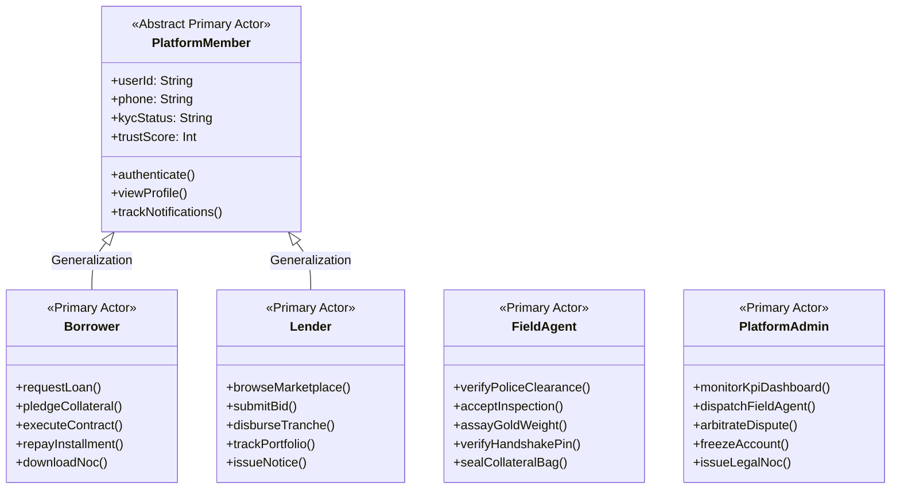

### Secondary & External System Actors
1. **`NPCI_UPI` (National Payments Corporation of India):** External payment rail executing instant peer transfers (`upi://pay`), generating dynamic QR codes, and reconciling UTRs with **INR 0.00 platform float**.
2. **`DigiLocker_UIDAI`:** Government OAuth 2.0 gateway validating Aadhaar identity XML and PAN verification records.
3. **`NeSL_EStamping`:** Licensed Digital Document Execution (DDE) gateway securing state-specific digital stamp certificates under Article 49 of the Indian Stamp Act, 1899.
4. **`MLKit_Vision`:** On-device Google ML Kit Vision subsystem executing facial landmark tracking and liveness detection.
5. **`Telegram_Bot`:** Autonomous webhook alert engine (`@Loanzo_bot`) dispatching real-time transactional, OTP, and fraud alerts.
6. **`Cloud_Firestore`:** Remote encrypted NoSQL data store maintaining reactive event listeners and cross-device document sync.

---

## 3. Master UML Use Case Diagram (System Boundary)

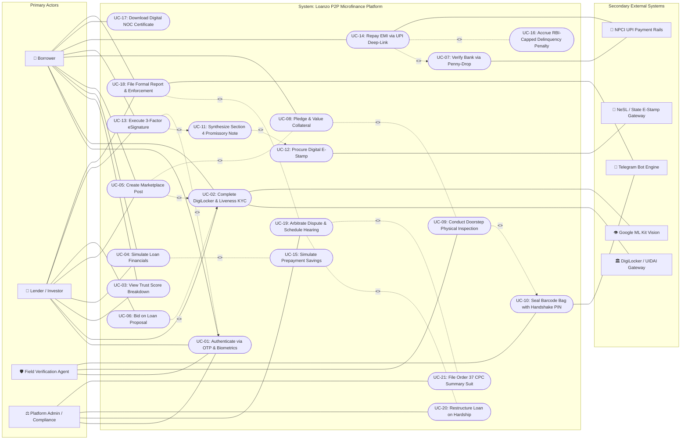

---

## 4. Subsystem Modular Use Case Diagrams

### 4.1 Subsystem 1: Identity, Multi-Factor Authentication & Trust Scoring
Governed by requirements **FR-AUTH-01 to 04** and **FR-KYC-01 to 04**.

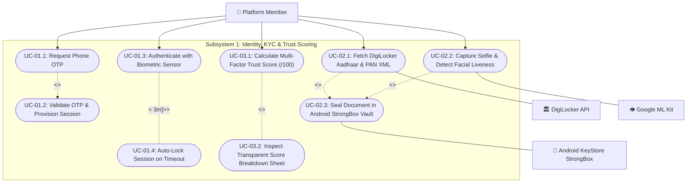

---

### 4.2 Subsystem 2: Social Marketplace, Competitive Bidding & Origination
Governed by requirements **FR-MKT-01 to 05** and **FR-LOAN-01 to 04**.

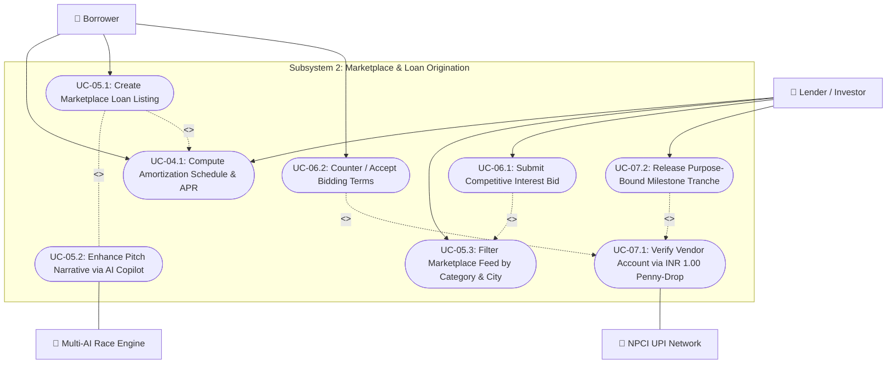

---

### 4.3 Subsystem 3: Doorstep Collateral Valuation, Assaying & Vaulting
Governed by requirements **FR-COL-01 to 04** and **FR-AGT-01 to 04**.

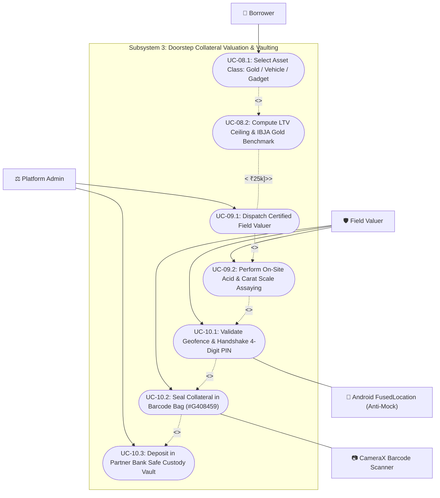

---

### 4.4 Subsystem 4: Statutory Contract Synthesis, E-Stamping & 3-Factor eSign
Governed by requirements **FR-AGR-01 to 04**.

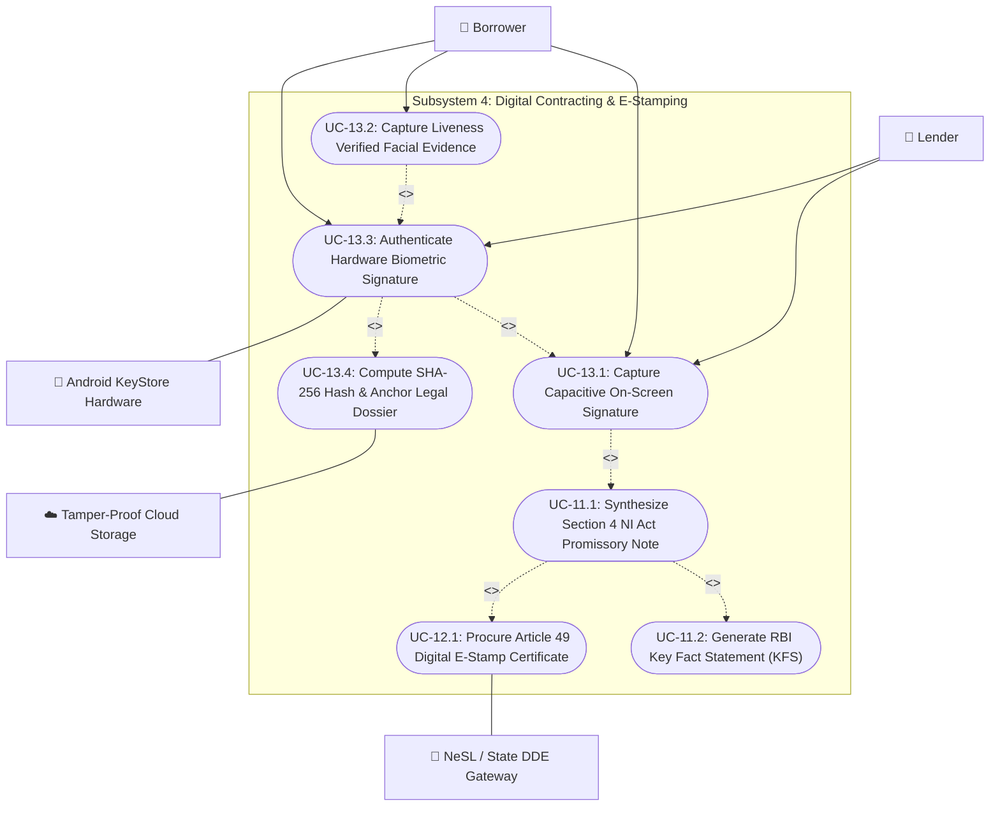

---

### 4.5 Subsystem 5: Servicing, Repayment Engine & Delinquency Recovery
Governed by requirements **FR-PAY-01 to 04** and **FR-DEL-01 to 04**.

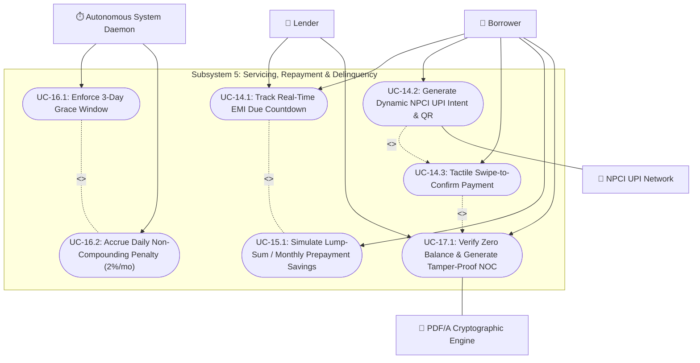

---

### 4.6 Subsystem 6: Field Agent Isolation, Dispatch & Inspection Cockpit
Governed by requirement **FR-AGT-01 to 04**.

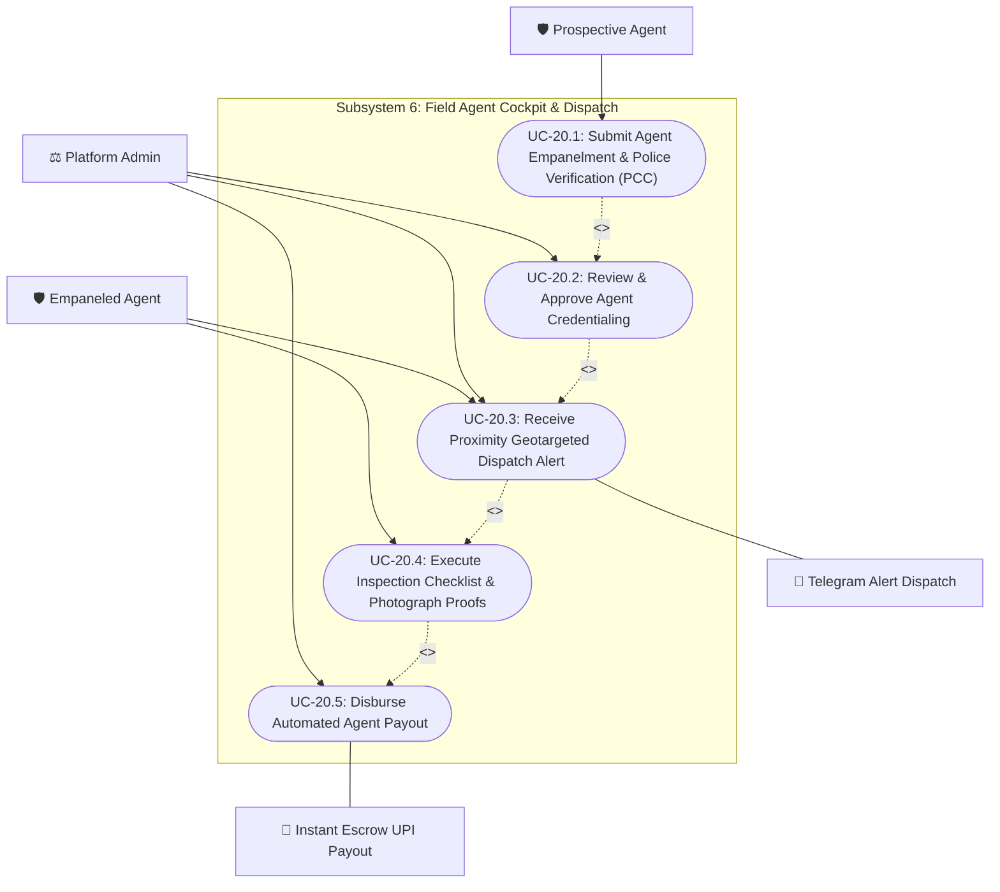

---

### 4.7 Subsystem 7: Compliance Governance, Dispute Arbitration & Admin Desk
Governed by requirements **FR-ADM-01 to 04** and **FR-AUD-01 to 04**.

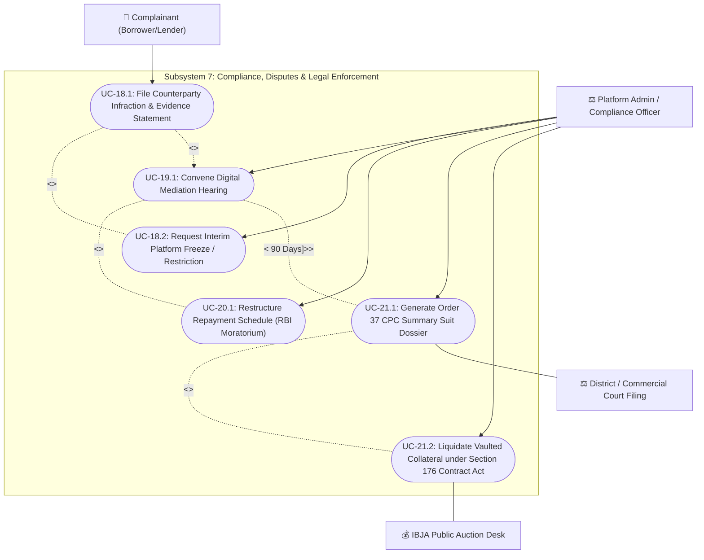

---

## 5. Formal GFG-Style Use Case Specifications

Following the **GeeksforGeeks Software Engineering & Alistair Cockburn** templates, below are the formal specifications for the six mission-critical use cases.

---

### 5.1 UC-01: Authenticate User & Bind Cryptographic Session
| Attribute | Specification Details |
|---|---|
| **Use Case ID** | `UC-AUTH-01` |
| **Use Case Name** | Authenticate User & Bind Cryptographic Session |
| **Scope** | Loanzo Mobile Client & Session Management Engine |
| **Level** | User-Goal Level |
| **Primary Actor** | Platform Member (Borrower / Lender / Field Agent) |
| **Secondary Actors** | Telecom SMS Gateway, Android KeyStore / StrongBox Hardware |
| **Stakeholders & Interests** | **User:** Quick, seamless access without passwords. **Platform:** Strong biometric repudiation, zero credential stuffing vulnerability. |
| **Preconditions** | User device possesses hardware biometric sensor (Class 3) and valid SIM card. |
| **Postconditions** | Hardware-backed JWT issued; 3-minute banking session timeout armed; Room local DB unlocked. |
| **Trigger** | User launches the application on a cold start or session timeout expiry. |

#### Main Success Scenario (Happy Path):
1. User enters registered 10-digit Indian Mobile Number.
2. System dispatches a cryptographically secure 6-digit OTP via carrier gateway.
3. System captures OTP via Google Play SMS Retriever API and auto-verifies signature.
4. System prompts the user for local biometric authentication via Android `BiometricPrompt`.
5. User provides authentic biometric (Fingerprint or Face scan).
6. Android KeyStore verifies signature against hardware StrongBox enclave.
7. System decrypts user profile session keys, loads active loans, and presents the Home Dashboard.

#### Extensions & Alternative Flows:
- **3a. SMS Retriever Fails / Times out (> 15 seconds):**
  - 3a1. System displays manual OTP input field with 30-second countdown timer.
  - 3a2. User inputs 6-digit code manually.
- **5a. Biometric Hardware Not Enrolled / Fingerprint Dirty:**
  - 5a1. System allows fallback to device screen lock PIN / Pattern.
  - 5a2. System logs authentication tier downgrade in `AuditEventEntity`.
- **5b. 3 Consecutive Biometric Failures:**
  - 5b1. Biometric sensor is temporarily locked for 30 seconds by Android OS.
  - 5b2. Application prompts for Device Credentials (PIN/Password).

---

### 5.2 UC-05: Publish Social Loan Listing & Community Broadcast
| Attribute | Specification Details |
|---|---|
| **Use Case ID** | `UC-MKT-01` |
| **Use Case Name** | Publish Social Loan Listing on Community Wall |
| **Scope** | Social Marketplace Subsystem |
| **Level** | User-Goal Level |
| **Primary Actor** | Verified Borrower / Capital Provider |
| **Secondary Actors** | Multi-AI Copilot Engine, Firebase Cloud Firestore |
| **Preconditions** | User has completed DigiLocker KYC; has no unserviced defaults > 90 days. |
| **Postconditions** | Loan listing published to global feed; visible to peer counterparties; immutable audit event logged. |

#### Main Success Scenario (Happy Path):
1. User selects "Request Loan" or "Offer Capital" from Dashboard or Marketplace.
2. User selects Category (Education, Medical, Business, Emergency, Personal, Agriculture).
3. User inputs Target Capital Amount, Interest Rate (% p.a.), and Tenure (Months).
4. System calculates live monthly installment (EMI), total interest, and effective APR.
5. User enters listing headline and loan purpose narrative.
6. User taps "AI Enhance" to refine narrative clarity and credibility.
7. System races SambaNova, LLM7, and Cloudflare AI, injecting high-impact financial phrasing within 800ms.
8. User selects city proximity and attaches optional collateral or co-borrower reference.
9. User reviews legal declaration and taps "Publish to Community Wall".
10. System generates a unique `postId`, synchronizes across Firestore, and triggers wall discovery.

#### Extensions & Alternative Flows:
- **3a. Entered Interest Rate Exceeds State Usury Cap (> 36% p.a.):**
  - 3a1. System highlights text field in red with statutory notice: *"Rate exceeds allowable limits"*.
  - 3a2. System clamps input to statutory ceiling.
- **6a. Offline / Airplane Mode Active:**
  - 6a1. Multi-AI Race Engine falls back to internal on-device heuristic rulebook.
  - 6a2. Listing is saved in local Room SQLite database and queued for WorkManager background sync.

---

### 5.3 UC-09: Synthesize Section 4 Promissory Note & Digital Stamp
| Attribute | Specification Details |
|---|---|
| **Use Case ID** | `UC-AGR-01` |
| **Use Case Name** | Synthesize Section 4 NI Act Promissory Note & Digital E-Stamp |
| **Scope** | Legal Contract Execution Engine |
| **Level** | Sub-function / Core Transaction |
| **Primary Actor** | Borrower & Lender Counterparties |
| **Secondary Actors** | NeSL / State E-Stamping Gateway, Cloud PDF/A Storage Gateway |
| **Preconditions** | Loan bid agreed by both counterparties; KYC verified; bank account validated. |
| **Postconditions** | Tamper-evident PDF/A contract generated with affixed e-stamp duty certificate; SHA-256 hash sealed. |

#### Main Success Scenario (Happy Path):
1. System triggers contract generation upon mutual loan bid acceptance.
2. System pulls verified legal names, PANs, addresses, principal amount, tenure, and repayment schedule.
3. System formulates statutory clauses compliant with Section 4 Negotiable Instruments Act, 1881.
4. System executes REST API handshake with NeSL / State DDE Gateway to procure digital e-stamp certificate.
5. Digital Stamp Certificate number and state duty serial are embedded into the contract preamble.
6. Borrower reviews contract terms, Key Fact Statement (KFS), and payment schedule.
7. Borrower applies on-screen signature and performs biometric verification.
8. Lender reviews and countersigns using biometric credential.
9. System generates cryptographic SHA-256 digest, embeds visual watermarks, and uploads copy to secure cloud vault.

#### Extensions & Alternative Flows:
- **4a. State E-Stamping Gateway Offline / Unresponsive:**
  - 4a1. System attempts secondary state portal gateway.
  - 4a2. If unresolvable within 45s, contract generation is queued with status `PENDING_ESTAMP`.
  - 4a3. Parties are notified that legal stamping is processing in background.

---

### 5.4 UC-11: Doorstep Physical Inspection & Tamper-Evident Bag Sealing
| Attribute | Specification Details |
|---|---|
| **Use Case ID** | `UC-COL-01` |
| **Use Case Name** | Doorstep Physical Inspection & Tamper-Evident Bag Sealing |
| **Scope** | Field Agent Cockpit & Collateral Custody Engine |
| **Level** | User-Goal Level |
| **Primary Actor** | Certified Field Verification Agent |
| **Secondary Actors** | Borrower, Android GPS Provider, CameraX Barcode Scanner |
| **Preconditions** | Agent empanelled and police verified; Borrower scheduled doorstep inspection. |
| **Postconditions** | Collateral item photographed, assayed, sealed in barcode bag `#G408459`, and logged for vault deposit. |

#### Main Success Scenario (Happy Path):
1. Agent arrives at borrower's geotagged residence and opens Loanzo Field Cockpit.
2. Agent requests 4-digit Handshake PIN generated on borrower's app.
3. Agent inputs PIN; system validates borrower proximity within 50 meters via GPS.
4. Agent inspects collateral item (e.g. Gold Jewelry), performs carat acid testing and net weight measurement.
5. Agent inputs net purity and grams; app calculates real-time valuation against live IBJA market rates.
6. Agent takes high-resolution evidentiary photographs of asset and valuation scale.
7. Agent places asset into heavy-duty tamper-evident security bag (Serial `#G408459`).
8. Agent scans bag barcode using CameraX scanner.
9. Borrower signs physical custody receipt on agent's touchscreen.
10. System locks collateral status to `VAULT_DISPATCH_TRANSIT` and notifies lender.

#### Extensions & Alternative Flows:
- **3a. GPS Mock Location / Developer Mode Spoofing Detected:**
  - 3a1. System rejects check-in immediately.
  - 3a2. Inspection form is locked; security incident flagged to Compliance Admin.
- **5a. Asset Discrepancy (Weight or Purity lower than declared):**
  - 5a1. System dynamically recalculates maximum allowable loan-to-value (LTV 75%).
  - 5a2. Borrower receives prompt to accept revised sanctioned loan amount or cancel inspection.

---

### 5.5 UC-14: Repay EMI & Simulate Prepayment Foreclosure Savings
| Attribute | Specification Details |
|---|---|
| **Use Case ID** | `UC-PAY-01` |
| **Use Case Name** | Repay EMI & Simulate Prepayment Foreclosure Savings |
| **Scope** | Loan Servicing & Repayment Engine |
| **Level** | User-Goal Level |
| **Primary Actor** | Borrower |
| **Secondary Actors** | Lender, NPCI UPI Payment App (GPay/PhonePe/Paytm) |
| **Preconditions** | Active loan contract in servicing phase; outstanding principal > 0. |
| **Postconditions** | Repayment recorded in Room SQLite and Firestore; outstanding principal amortized; receipt issued. |

#### Main Success Scenario (Happy Path):
1. Borrower navigates to Active Loan card displaying EMI countdown and amount due.
2. *(Optional Branch)* Borrower opens "Prepayment Calculator" to simulate lump-sum or extra monthly top-up.
3. System visualizes reduced tenure, total interest saved, and new debt-free date.
4. Borrower taps "Pay Now" or executes tactile "Swipe to Pay" slider.
5. System generates dynamic UPI deep-link containing lender VPA, exact EMI amount, and loan reference tag.
6. External UPI selector opens (Google Pay, PhonePe, Paytm, BHIM).
7. Borrower completes UPI PIN authentication in banking app.
8. Banking app returns transaction success payload and 12-digit UTR reference number.
9. Loanzo validates UTR, updates repayment ledger, and reduces outstanding principal.
10. If final installment, system triggers **UC-17 (Issue Digital NOC Certificate)**.

#### Extensions & Alternative Flows:
- **7a. Borrower Exits UPI App without Paying / Transaction Fails:**
  - 7a1. System displays: *"Payment not completed or pending bank confirmation"*.
  - 7a2. Allows borrower to manually input 12-digit bank UTR for automated backend reconciliation.
- **9a. Due Date Exceeded by > 3 Days (Grace Window Expired):**
  - 9a1. System triggers **UC-16**, automatically applying simple, non-compounding penal charges (2.0%/mo).

---

### 5.6 UC-18: Formal Violation Reporting & Summary Suit Escalation
| Attribute | Specification Details |
|---|---|
| **Use Case ID** | `UC-ADM-01` |
| **Use Case Name** | File Formal Incident Report & Escalate Legal Action |
| **Scope** | Compliance, Arbitration & Legal Enforcement Engine |
| **Level** | User-Goal Level |
| **Primary Actor** | Aggrieved Counterparty (Borrower or Lender) |
| **Secondary Actors** | Platform Compliance Admin, Telegram Bot Dispatcher |
| **Preconditions** | Contractual default, KYC breach, harassment, or agreement covenant failure. |
| **Postconditions** | Digital incident docket created; compliance audit logged; Telegram alert dispatched to Admin. |

#### Main Success Scenario (Happy Path):
1. User taps "Report & Take Action" from Navigation Drawer or Contract Details.
2. System navigates to full-screen dedicated compliance portal (`Routes.REPORT_ACTION`).
3. User selects counterparty from quick chips or uses `UserPickerDropdown`.
4. User selects Infraction Category (Default / Non-Payment, Fraud / Fake KYC, Harassment & Abuse, Agreement Breach).
5. User selects Incident Severity (Low, Medium, High).
6. User enters factual narrative statement and attaches evidence document references.
7. User selects requested enforcement remedies (Account Restriction / Freeze, Section 138 Notice, Admin Review).
8. User taps "Submit Formal Report & Take Action".
9. System generates unique `complaintId`, persists to Room `complaints` table, and dispatches HMAC webhook to Telegram `@Loanzo_bot`.
10. Admin reviews case on Admin Hub, convenes Digital Mediation hearing or initiates Order 37 CPC Summary Recovery.

---

## 6. Use Case Driven Software Testing (UCDT) Framework

In modern software testing (ISTQB / IEEE 829), use cases provide the fundamental baseline for designing **Functional System Tests**, **End-to-End (E2E) Acceptance Tests**, and **Boundary Test Suites**.

### 6.1 Test Scenario Derivation Methodology
For every Use Case:
1. **Happy Path Flow $\rightarrow$ Test Scenario 1 (Positive / Smoke Test):** Validates basic functionality under ideal inputs.
2. **Alternative Flows $\rightarrow$ Test Scenarios 2..N (Functional Variations):** Validates optional features and auxiliary branches.
3. **Exception Flows $\rightarrow$ Test Scenarios N+1..M (Negative / Security Tests):** Validates fault tolerance, invalid inputs, and error handlers.

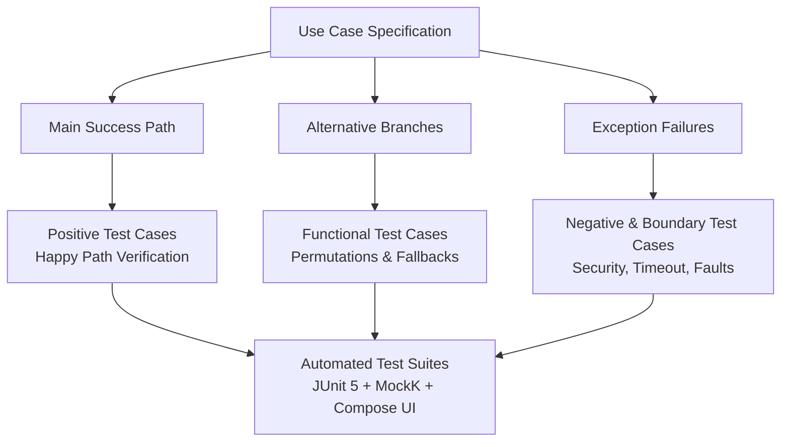

---

### 6.2 Boundary Value Analysis (BVA) & Equivalence Partitioning Matrix

| Parameter / Variable | Valid Equivalence Class (Valid Inputs) | Invalid Equivalence Class (Invalid Inputs) | Boundary Values (BVA Test Values) |
|---|---|---|---|
| **Loan Amount ($P$)** | ₹1,000 to ₹10,00,000 | $< ₹1,000$ or $> ₹10,00,000$ | ₹999 (Fail), ₹1,000 (Pass), ₹10,00,000 (Pass), ₹10,00,001 (Fail) |
| **Interest Rate ($R$)** | 4.0% to 36.0% p.a. | $< 4.0\%$ or $> 36.0\%$ | 3.9% (Fail), 4.0% (Pass), 36.0% (Pass), 36.1% (Fail) |
| **Tenure ($T$)** | 1 to 120 Months | $< 1$ month or $> 120$ months | 0 Mo (Fail), 1 Mo (Pass), 120 Mo (Pass), 121 Mo (Fail) |
| **Grace Window** | 1 to 3 Days post due date | $> 3$ days | Day 3 (No Penalty), Day 4 (2% Simple Penalty Triggered) |
| **Gold Loan LTV** | $\le 75.0\%$ of IBJA net value | $> 75.0\%$ | 74.9% (Pass), 75.0% (Pass), 75.1% (Fail / Clamp) |
| **Session Inactivity** | $\le 180$ seconds | $> 180$ seconds | 179s (Active), 180s (Active), 181s (Auto-Lock Engaged) |
| **Handshake PIN** | Exactly 4 digits [0-9] | Letters, symbols, $<4$ or $>4$ digits | "123" (Fail), "1234" (Pass), "12345" (Fail), "12a4" (Fail) |

---

### 6.3 Comprehensive QA Test Case Suite

| Test Case ID | Target Use Case | Test Objective | Input Data / Precondition | Expected System Behavior | Test Level | Automated Test Implementation File |
|---|---|---|---|---|---|---|
| **TC-AUTH-01** | `UC-01` | Verify phone OTP verification | Phone: `9876543210`, OTP: `123456` | User authenticated; JWT issued; Home opened | Unit / Integration | [`AuthViewModelTest.kt`](file:///c:/AndroidProjects/loanzo/app/src/test/java/com/loanzo/app/ui/auth/AuthViewModelTest.kt) |
| **TC-AUTH-02** | `UC-01` | Verify biometric session lock on 3m timeout | App backgrounded for 185 seconds | `SessionLockScreen` rendered; requires biometric/PIN | UI Instrumented | [`SessionLockTest.kt`](file:///c:/AndroidProjects/loanzo/app/src/androidTest/java/com/loanzo/app/ui/auth/SessionLockTest.kt) |
| **TC-KYC-01** | `UC-02` | Verify ML Kit liveness selfie capture | Camera front capture, blinking face | Landmark detected; `isLive = true`; cached JPG saved | Unit / Mock | [`KycLivenessTest.kt`](file:///c:/AndroidProjects/loanzo/app/src/test/java/com/loanzo/app/ui/auth/KycLivenessTest.kt) |
| **TC-MKT-01** | `UC-05` | Verify usury cap enforcement on post creation | Amount: ₹50,000, Rate: `38.5%` | System clamps rate to `36.0%`; warning displayed | Unit Test | [`MarketplaceViewModelTest.kt`](file:///c:/AndroidProjects/loanzo/app/src/test/java/com/loanzo/app/ui/marketplace/MarketplaceViewModelTest.kt) |
| **TC-MKT-02** | `UC-05` | Verify Multi-AI Race Engine pitch enhancement | Prompt: *"Urgent fee loan"*, Category: `EDUCATION` | Winner responds $< 2000$ms; narrative updated | Integration | [`MultiAiRaceEngineTest.kt`](file:///c:/AndroidProjects/loanzo/app/src/test/java/com/loanzo/app/data/ai/MultiAiRaceEngineTest.kt) |
| **TC-COL-01** | `UC-08` | Verify gold LTV calculation against IBJA rates | 22K Gold, 10.0g net weight, IBJA ₹7,000/g | Valuation ₹70,000; Max LTV sanctioned ₹52,500 (75%) | Unit Test | [`CollateralValuationTest.kt`](file:///c:/AndroidProjects/loanzo/app/src/test/java/com/loanzo/app/util/CollateralValuationTest.kt) |
| **TC-COL-02** | `UC-10` | Verify GPS mock location detection during inspection | FusedLocation provider reporting mock flag | Check-in blocked; error dialog: *"Mock location detected"* | Instrumented | [`FieldAgentInspectionTest.kt`](file:///c:/AndroidProjects/loanzo/app/src/androidTest/java/com/loanzo/app/ui/agent/FieldAgentInspectionTest.kt) |
| **TC-AGR-01** | `UC-11` | Verify Section 4 Promissory Note PDF generation | Loan ID `LN-101`, Principal ₹1,00,000 | PDF/A file created; SHA-256 hash generated; non-empty | Unit Test | [`LoanzoPdfEngineTest.kt`](file:///c:/AndroidProjects/loanzo/app/src/test/java/com/loanzo/app/util/pdf/LoanzoPdfEngineTest.kt) |
| **TC-PAY-01** | `UC-14` | Verify dynamic UPI deep-link generation | VPA: `lender@okaxis`, Amount: `₹8,885.00` | URI matches `upi://pay?pa=...&am=8885.00&cu=INR` | Unit Test | [`UpiQrCodeTest.kt`](file:///c:/AndroidProjects/loanzo/app/src/test/java/com/loanzo/app/ui/components/UpiQrCodeTest.kt) |
| **TC-PAY-02** | `UC-15` | Verify prepayment foreclosure savings math | Principal ₹1,00,000, Lump sum ₹20,000 | Output interest saved $> 0$; tenure months reduced | Unit Test | [`LoanCalculatorTest.kt`](file:///c:/AndroidProjects/loanzo/app/src/test/java/com/loanzo/app/util/LoanCalculatorTest.kt) |
| **TC-DEL-01** | `UC-16` | Verify 3-day grace period penalty suppression | Overdue by 2 days | Late penalty = ₹0.00; status = `ACTIVE_GRACE` | Unit Test | [`DelinquencyEngineTest.kt`](file:///c:/AndroidProjects/loanzo/app/src/test/java/com/loanzo/app/data/repository/DelinquencyEngineTest.kt) |
| **TC-DEL-02** | `UC-16` | Verify RBI 2%/month non-compounding penalty cap | Principal ₹1,00,000, Overdue by 30 days | Daily penalty accrued $= 1,00,000 \times 0.02 = ₹2,000$ | Unit Test | [`DelinquencyEngineTest.kt`](file:///c:/AndroidProjects/loanzo/app/src/test/java/com/loanzo/app/data/repository/DelinquencyEngineTest.kt) |
| **TC-ADM-01** | `UC-18` | Verify Report & Take Action submission | Target: `user_404`, Category: `FRAUD` | Complaint saved in Room; Telegram alert webhook sent | Integration | [`ReportActionScreenTest.kt`](file:///c:/AndroidProjects/loanzo/app/src/test/java/com/loanzo/app/ui/dashboard/ReportActionScreenTest.kt) |
| **TC-NOC-01** | `UC-17` | Verify digital NOC generation on zero balance | Disbursed ₹50,000, Outstanding ₹0.00 | NOC button enabled; PDF download ready with seal | UI Instrumented | [`LoanScreensTest.kt`](file:///c:/AndroidProjects/loanzo/app/src/androidTest/java/com/loanzo/app/ui/loan/LoanScreensTest.kt) |

---

## 7. Requirements Traceability Matrix (RTM)

This matrix maps IEEE 830 Functional Requirements directly to UML Use Cases and their corresponding Software Verification Test Cases.

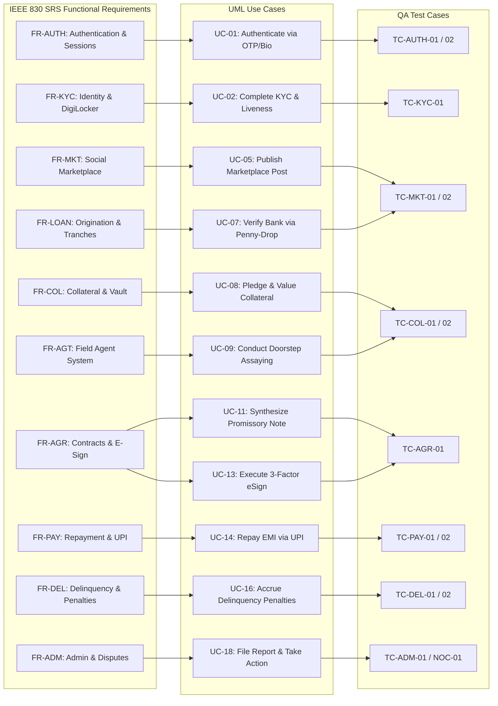

---

## 8. Summary & Verification Conclusion

This specification provides a complete, mathematically grounded, and statutory-compliant Software Engineering deliverable for the **Loanzo Protocol**. By applying OMG UML 2.5 standards alongside GeeksforGeeks and IEEE 830 best practices:
1. **Architects and Developers** have an unambiguous reference for actor boundaries, package dependencies, and transactional scopes.
2. **QA and Test Automation Engineers** have a direct, 1-to-1 derivation pipeline from use case paths to boundary value test suites and automated test classes.
3. **Auditors and Regulators** can trace every functional capability directly back to RBI P2P Directions, Section 4 of the Negotiable Instruments Act, 1881, and Order 37 CPC summary recovery rules.
